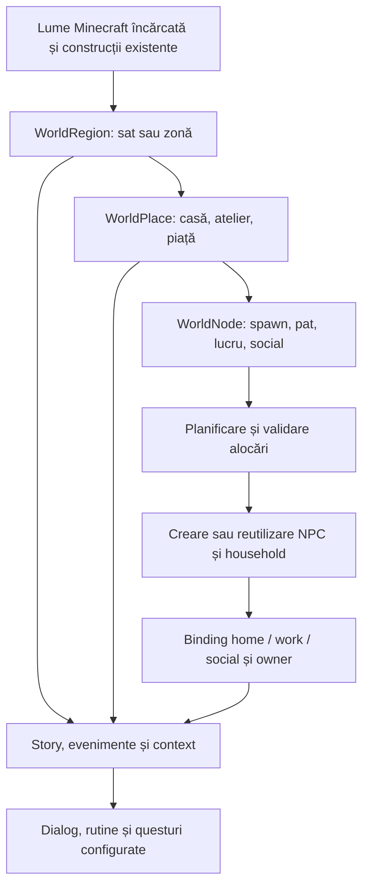

# Inițiere lume, hartă, structuri, NPC și story

Status: ghid de configurare bazat pe implementarea din workspace.
Verificat: 2026-10-05. Verificarea este statică; nu reprezintă un test pe server.

Acest ghid explică ordinea în care pregătești o lume pentru AINPC, ce proprietăți configurezi la fiecare nivel și unde se salvează rezultatul. Referințele de mai jos conțin cheile, valorile implicite, exemplele YAML și comenzile detaliate.

## 1. Configurația pentru fiecare domeniu

| Domeniu | Ce stabilești | Referință |
|---|---|---|
| Lume și hartă | Profilul platformei, lumea Minecraft existentă, regiuni, limite, tipuri și indexare | [Configurare lume, hartă și generare](../reference/configurare-lume-harta-generare.md) |
| Structuri și generare | Places, nodes, template-uri, scanare, reguli de amplasare și starea generatorului fizic | [Configurare lume, hartă și generare](../reference/configurare-lume-harta-generare.md) |
| NPC și populație | Proprietăți inițiale, planificare, familie, household, spawn și comportament | [Configurare NPC și asociere cu structuri](../reference/configurare-npc-asociere-structuri.md) |
| Asocieri NPC–structuri | Casă, loc de muncă, loc social, puncte concrete și proprietar | [Configurare NPC și asociere cu structuri](../reference/configurare-npc-asociere-structuri.md) |
| Story | Mod narativ, stare regională/locală, evenimente, context și conținut de scenariu | [Configurare story pentru lume și NPC](../reference/configurare-story-lume-npc.md) |

Documentele de arhitectură existente rămân referința pentru proiectarea serviciilor. Acest set documentează configurarea și operarea lor împreună.

Pentru aplicarea pas cu pas, folosește [exemplul complet de sat, fierar și story](exemplu-complet-sat-npc-story.md), cu fișier de mapping și rezultate așteptate la fiecare etapă.

Pentru mai mulți NPC în aceeași casă, continuă cu [exemplul de familie și proprietar](exemplu-familie-proprietar-npc.md): capacitate, puncte individuale, ocupații distincte și delimitarea rezidenței de proprietate.

## 2. Ce înseamnă „inițializarea lumii”

Există două operații diferite:

- **Pornirea tehnică:** Paper încarcă lumea Minecraft, apoi AINPC încarcă configurația, mapping-ul, NPC-urile persistente și serviciile.
- **Pregătirea conținutului:** administratorul definește regiunile, structurile și punctele de interes, verifică planul de populație, creează NPC-urile și configurează story-ul.

`platform.world_mode` este un profil AINPC. Nu setează seed-ul, generatorul de teren sau tipul lumii Minecraft. O regiune AINPC nu creează o lume Minecraft, iar un `Place` nu construiește automat blocurile clădirii.



## 3. Unde se configurează și unde se salvează

Fișierele de mai jos sunt relative la directorul de date al pluginului, în mod obișnuit `plugins/AINPC/`. Fișierele din `src/main/resources/` sunt șabloanele livrate în JAR; editarea lor în repo nu schimbă configurația unui server deja pornit.

| Strat | Sursă/configurare | Persistență și efect |
|---|---|---|
| Opțiuni globale | `config.yml` | Controlează platforma și serviciile; unele opțiuni se citesc numai la pornire |
| Mapping semantic | `world_admin` din config, înlocuit de primul overlay recunoscut | `/ainpc world save` scrie mapping-ul în `config.yml`; overlay-ul trebuie sincronizat separat |
| Overlay uzual | `world-admin.yml`; există și variante JSON/YAML și fallback `castel-world-admin.yml` | Un fișier cu prioritate mai mare poate ascunde modificările făcute într-un alt overlay |
| Template-uri de clădiri | `building_templates.yml` | Catalog validat la startup/reload, consumat de auto-place semantic; transmite metadata către mapping/NPC/story |
| Definiții de așezări | `settlements.yml` | Listarea definițiilor este disponibilă; nu este un plan complet executat de spawn |
| Populație persistentă | DB selectată prin `database.*` | NPC-uri, profiluri, households, binding-uri și istoricul batch-urilor au persistări distincte |
| Story din mapping | Proprietățile `story` ale regiunii | Se salvează odată cu mapping-ul |
| Story dinamic | Serviciile story și DB | Stări de regiune/place, variabile și evenimente; nu este echivalent cu secțiunea `story` din mapping |
| Scenarii și questuri | `packs/`, conținutul addonurilor și `quests.yml`, după subsistem | Definițiile se încarcă separat de progresul jucătorilor |

Ordinea overlay-urilor și schema exactă sunt în [referința de lume](../reference/configurare-lume-harta-generare.md). Nu întreține simultan copii divergente ale aceleiași hărți în mai multe formate.

**Înainte de reload/restart:** salvarea nu actualizează overlay-ul. Copiază secțiunea completă `world_admin` salvată în overlay-ul prioritar, conform procedurii din referință. Altfel, un overlay vechi sau minimal poate înlocui mapping-ul tocmai salvat.

## 4. Ce se întâmplă la pornirea pluginului

1. `AINPCPlugin.onEnable()` încarcă valorile implicite din config, validează configurația și copiază resursele inițiale absente, inclusiv fișierele de mapping/template-uri și pack-ul de compatibilitate.
2. `ServiceRegistry` inițializează platforma și serviciile de persistență, conectează baza de date și reîncarcă profilul/mapping-ul.
3. Sunt inițializate serviciile AI și încărcate feature pack-urile.
4. `NPCManager` încarcă NPC-urile persistente, descoperă villagerii existenți, reconciliază duplicatele și încearcă restaurarea NPC-urilor lipsă în chunk-urile încărcate. Completează apoi profilurile și binding-urile care pot fi deduse din ancore.
5. Sunt inițializate engine-urile, progresul questurilor, story-ul, economia, GUI-ul și celelalte servicii de domeniu.
6. Sunt înregistrate comenzile/listener-ele și pornesc watcher-ul și scheduler-ele. Este inițializat și serviciul intern WorldGen cu executorul ales.

Această pornire nu execută automat un plan nou de sat complet. Încărcarea unui serviciu, a unui fișier sau a unei proprietăți nu garantează existența unei comenzi care consumă acel conținut.

Surse: [AINPCPlugin](../../ainpc-core-plugin/src/main/kotlin/ro/ainpc/AINPCPlugin.kt), [ServiceRegistry](../../ainpc-core-plugin/src/main/kotlin/ro/ainpc/bootstrap/ServiceRegistry.kt), [SchedulerCoordinator](../../ainpc-core-plugin/src/main/kotlin/ro/ainpc/bootstrap/SchedulerCoordinator.kt).

## 5. Procedură pentru un sat nou

### Pasul 1 — Alege lumea și proprietățile globale

Pregătește o lume Minecraft încărcată și o zonă cunoscută. Configurează profilul `platform`, activarea mapping-ului și serviciile necesare în `config.yml`, conform [referinței de lume](../reference/configurare-lume-harta-generare.md).

Pentru prima configurare păstrează activarea rutinei și simulării pentru momentul în care există ținte valide. Configurația livrată are `features.routine=true` și `features.simulation=true`, dar `routine.enabled=false` și `simulation.enabled=false`.

### Pasul 2 — Definește harta semantică

Creează sau importă un `WorldRegion`, apoi `WorldPlace` pentru fiecare structură și `WorldNode` pentru punctele utilizabile. Folosește [mapping-ul pentru hărți manuale](mapping-harti-manuale.md) sau scanarea/importul descrise în referința de lume.

Pentru un exemplu de sat, alege un ID unic precum `sat_demo`. O casă poate avea ID-ul calificat `sat_demo:casa_01`; folosește ID-urile returnate de comenzi pentru nodes și asocieri.

O casă destinată spawn-ului trebuie să ofere node-urile și capacitatea cerute de planner. O clădire doar vizuală, fără mapping și puncte utilizabile, nu este suficientă pentru alocarea unui household.

```text
/ainpc audit world
/ainpc world save
```

### Pasul 3 — Verifică structurile și planul de populație

Inspectează tipul casei, limitele, pozițiile de spawn și paturile, apoi planifică populația. Comenzile și regulile exacte sunt în [referința NPC](../reference/configurare-npc-asociere-structuri.md).

```text
/ainpc world settlement plan sat_demo
```

Corectează erorile de alocare înainte de spawn. Planificarea narativă `PopulationPlan` și configurația `settlements.yml` nu înlocuiesc automat planner-ul de alocare consumat de spawn.

### Pasul 4 — Creează populația și verifică asocierile

```text
/ainpc world settlement spawn sat_demo --confirm
```

Verifică rezultatele pentru NPC-urile create/reutilizate, household-uri și binding-uri. Casa unui NPC, postul lui de lucru și proprietarul clădirii sunt relații diferite. Un NPC poate locui într-o casă fără să fie proprietarul ei.

Spawn-ul și asocierea în mapping nu sunt o singură tranzacție. Dacă apare „Succes parțial”, inspectează batch-ul și binding-urile înainte de a încerca încă un spawn. Starea completă cere verificarea fiecărui strat de persistență.

```text
/ainpc world save
/ainpc audit spawn
```

### Pasul 5 — Configurează story-ul și conținutul

Stabilește modul narativ al regiunii, starea inițială, evenimentele relevante și, unde sunt necesare, questurile/scenariile. Urmează exemplele din [referința story](../reference/configurare-story-lume-npc.md).

Păstrează faptele fizice în mapping și binding-uri: dacă un NPC este fierarul satului, asociază-i locul de muncă potrivit. Textul de lore sau o poveste generată nu creează singure un atelier și nu setează automat toate relațiile NPC-ului.

### Pasul 6 — Activează comportamentul și verifică restartul

Activează rutina și simularea după ce ai verificat punctele home/work/social și configurația lor. Salvează mapping-ul și sincronizează overlay-ul prioritar înainte de restart. Repornește controlat serverul pentru opțiunile care schimbă înregistrarea scheduler-elor sau executorului WorldGen.

După restart verifică aceleași ID-uri de regiune/place/node, NPC-uri, households, binding-uri și stări story. Persistența mapping-ului nu este o dovadă suficientă pentru persistența NPC-urilor sau a story-ului din DB.

## 6. Când folosești save, reload sau restart

| Operație | Folosește pentru | Limită |
|---|---|---|
| `/ainpc world save` | Modificări de mapping făcute în runtime | Nu este o comandă generală de salvare a NPC/story/quest |
| `/ainpc reload` | Config, profil/mapping, pack-uri și servicii reîncărcate explicit de `ServiceRegistry.reload()` | Nu recreează toate serviciile și nu repornește toate scheduler-ele |
| Reload de conținut | Pack-uri și template-uri de quest; reinițializează și serviciile story indicate în cod | Nu echivalează cu reîncărcarea tuturor setărilor globale |
| Restart controlat | Schimbări de backend DB, executor sau activare/intervale citite la crearea task-urilor | Necesită ca modificările runtime de mapping să fie deja salvate |

Salvează mapping-ul modificat și sincronizează overlay-ul înainte de reload: reîncărcarea îl reconstruiește din configurația și overlay-ul de pe disc, iar overlay-ul înlocuiește întreaga secțiune `world_admin`. Consultă referința fiecărui domeniu pentru comportamentul exact al setării modificate.

## 7. Verificări de acceptare

| Verificare | Rezultat așteptat |
|---|---|
| Lume/hartă | Lumea este încărcată; regiunea, places și nodes au lumi, limite și ID-uri coerente |
| Structuri | Tipul semantic corespunde clădirii; punctele de spawn/pat/lucru/social sunt utilizabile |
| Planificare | Planner-ul nu raportează alocări incompatibile sau lipsuri care blochează spawn-ul |
| NPC | Populația așteptată există; inspecția batch-ului și auditul nu indică duplicate sau eșecuri ignorate |
| Asocieri | Home/work/social și owner corespund rolurilor dorite; mapping-ul este salvat |
| Story | Contextul afișează regiunea/place-ul corect și stările/evenimentele configurate |
| Persistență | Aceleași relații și stări se regăsesc după restart |

Pentru validarea întregului demo continuă cu [Playable Village Runbook](../operations/playable-village-runbook.md). Acest ghid nu certifică executarea procedurii pe un server live.

## 8. Limitele actuale de reținut

Primul lot de implementare a conectat catalogul de clădiri la runtime. Vezi [schema, exemplul și starea etapelor următoare](../reference/template-config-runtime.md).

- Generarea de teren Minecraft, maparea semantică, construcția fizică și spawn-ul NPC sunt operații distincte.
- Există infrastructură WorldGen, însă opțiunile declarate și legăturile din comenzile publice au limitările enumerate în referința de generare.
- Nu există un singur YAML consumat de runtime care să inițializeze automat toate proprietățile lumii, structurilor, NPC-urilor și story-ului.
- Proprietățile configurabile global nu sunt automat proprietăți editabile individual pentru fiecare NPC sau structură.
- Documentele mai vechi pot descrie o etapă anterioară; pentru acest flux folosește comportamentul și sursele verificate în cele trei referințe de configurare.
