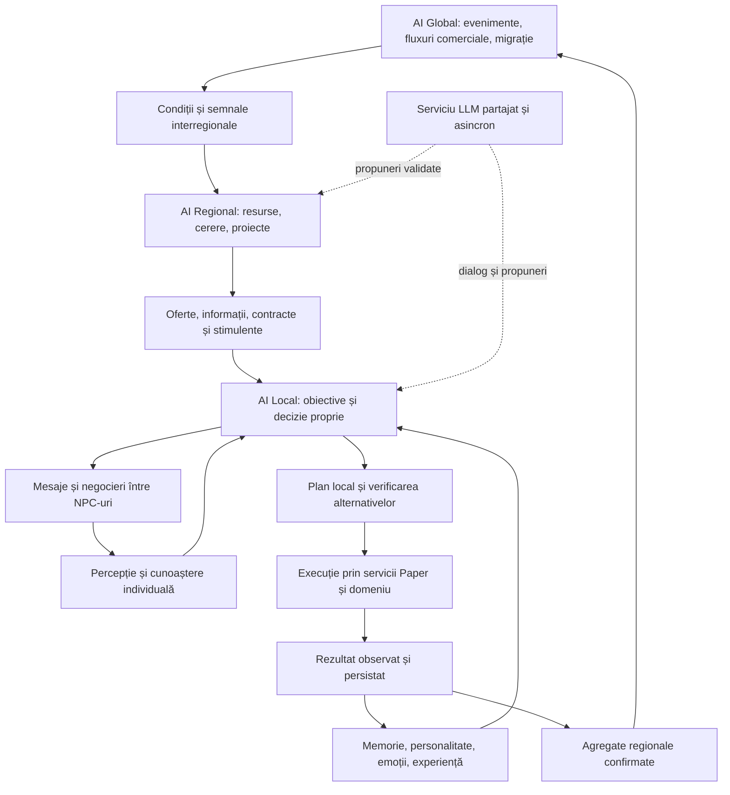

# Arhitectură agentică AINPC: AI Local, Regional și Global

Data: 2026-10-27.

Statut: **analiză a codului existent și propunere de integrare modulară** pentru cerințele detaliate ale utilizatorului. Nucleul AG1, integrarea limitată AG2, bugetul local, LOD-ul dinamic limitat, calculul pur, checkpoint-ul opțional al nevoilor, clasificarea absenței și rezervarea runtime a transferului AG3 sunt implementate în cod, conform secțiunii următoare; restul componentelor țintă rămân planificate. Validarea pe Paper este separată. [Rezumatul general](rezumat-general-ai-agentica.md) oferă o vedere scurtă a stadiului curent.

Documentul completează [cerințele pentru Codex](cerinte-codex-sistem-ai-avansat-npc-papermc.md). [Constituția](../canonical/constitutie-proiect.md), [contractul simulării](../architecture/simulation-service.md), [contractul dialogului](../architecture/dialog-si-conversatii.md) și [contractul de stocare](../reference/storage-runtime.md) păstrează autoritatea asupra runtime-ului curent.

## Progres: AG1, integrare AG2 și AG3 parțial

Implementat la 2026-10-27: [`NpcAgentSnapshot`](../../ainpc-core-plugin/src/main/kotlin/ro/ainpc/npc/NpcAgentSnapshot.kt), o captură cognitivă imuabilă cu identitate, revizii, moment și schemă. `DecisionEngine` și fabrica `PromptSnapshot` folosesc această proiecție comună. Nevoile și rutina pentru scorare nu mai pot fi înlocuite de copii vechi din context, iar câmpurile cognitive ale promptului păstrează starea capturată.

Continuare implementată: [`NpcPerceptionSnapshot`](../../ainpc-core-plugin/src/main/kotlin/ro/ainpc/npc/NpcPerceptionSnapshot.kt) extinde anvelopa agentului la schema `2`, cu o copie a percepției existente, fără scanări noi. Scorarea contextuală și proiecțiile de mediu/locație ale promptului folosesc această copie. [`NpcMemorySnapshot`](../../ainpc-core-plugin/src/main/kotlin/ro/ainpc/managers/NpcMemorySnapshot.kt) păstrează identitatea și proveniența selecției de memorii, distinge citirea validă de dezactivare/eroare și este integrat în fluxul DB al dialogului.

AG1 are astfel proiecții de bază pentru cogniție, percepție și memorie. Cunoașterea semantică individuală și reviziile tuturor surselor nu sunt încă reunite într-un snapshot tranzacțional. Contractele exacte sunt în [simulare](../architecture/simulation-service.md#snapshot-comun-al-agentului---primul-increment-ag1) și [dialog](../architecture/dialog-si-conversatii.md#memorie-contextuala-tipizata---continuare-ag1).

Primul increment AG2: [`NpcCarePlanner`](../../ainpc-core-plugin/src/main/kotlin/ro/ainpc/engine/NpcCarePlanner.kt) propune un obiectiv de îngrijire în maximum trei pași. Energia are alternativele somn/odihnă; foamea are numai masa, fără stocuri inventate. Flagul `simulation.decision.care_planner_shadow_enabled`, implicit `false`, afișează planul neexecutat în `/ainpc decision`, din același snapshot ca Utility AI. Verificarea explicită de invalidare include identitatea, reviziile, termenul și precondițiile care se pot schimba fără revizie. Este doar previzualizare la cerere, nu execuție sau simulare periodică; [contractul AG2](../architecture/simulation-service.md#planner-local-de-ingrijire---previzualizare-ag2) descrie limitele. Nivelurile Regional/Global rămân planificate.

Continuare AG2: [`NpcCarePlanExecutor`](../../ainpc-core-plugin/src/main/kotlin/ro/ainpc/engine/NpcCarePlanExecutor.kt), activabil separat prin `simulation.decision.care_planner_execution_enabled`, implicit `false`, poate aplica masa, somnul și odihna fără somn numai pentru NPC-uri `FULL` aflate fizic acasă, cu politicile runtime active. Reutilizează tranzițiile, observarea nevoilor și experiența existente; verifică precondițiile înainte și după evenimente, fără a certifica succesul prin simpla alegere. Deplasarea rămâne rutinei. [Contractul execuției controlate](../architecture/simulation-service.md#executie-controlata-a-ingrijirii-acasa---continuare-ag2) precizează fallback-ul Utility, întreruperile și validarea Paper rămasă.

Extinderea `REST` are monitorizare, continuitate cognitivă, protecție față de rutina obișnuită și experiență persistentă distincte de `SLEEP`. Recuperarea ambientală este scăzută înaintea calculului efectului învățat: odihna cu o creștere egală celei normale de acasă are efect `0`, fără avantaj cauzal inventat. Calea legacy nu pornește automat noile perioade de observare; [contractul odihnei](../architecture/simulation-service.md#odihna-fara-somn---extindere-ag2) detaliază compatibilitatea și limitele.

Primul increment AG3: [`NpcCarePlanningBatch`](../../ainpc-core-plugin/src/main/kotlin/ro/ainpc/engine/NpcCarePlanningBatch.kt) împarte între NPC-uri un plafon de încercări și un buget de admitere temporală per ciclu al managerului, cu rotație după ultimul actor admis și raport read-only. Reutilizează `PerformanceMonitor` cu o singură serie `tick.care_planner`. Capacitatea insuficientă nu oprește nevoile, reacțiile urgente sau îngrijirea deja validă. Limitele implicite sunt `32` de încercări și `2.0` ms, fără activarea implicită a executorului. Nu reprezintă încă AI LOD sau simulare abstractă; [contractul bugetului](../architecture/simulation-service.md#buget-comun-al-plannerului---primul-increment-ag3) precizează limitele soft, reentranța și măsurătorile rămase.

Continuare AG3: [`NpcSimulationLodPass`](../../ainpc-core-plugin/src/main/kotlin/ro/ainpc/npc/NpcSimulationLod.kt), activabil prin `simulation.lod.enabled`, implicit `false`, derivă detaliul `FULL/LIGHT` din proximitatea jucătorilor și importanța conservativă a actorului. Folosește raze cu histereză, un index spațial temporar comun și integrarea în simulare/rutină/socializare, fără schimbarea modului autorului. Pericolul proaspăt observat și îngrijirea activă păstrează detaliul complet. Nu simulează entități indisponibile și nu modifică salarizarea existentă; rărirea percepției este o extensie opt-in separată. [Contractul LOD](../architecture/simulation-service.md#ai-lod-dinamic-pentru-entitati-disponibile---continuare-ag3) descrie excepțiile, limitele de cost și separarea de cunoașterea NPC-ului.

Continuare AG3: [`NpcPerceptionRefreshHistory`](../../ainpc-core-plugin/src/main/kotlin/ro/ainpc/npc/NpcPerceptionRefresh.kt), prin `simulation.lod.perception.enabled`, implicit `false`, permite reutilizarea temporară a observațiilor pentru `FULL` redus dinamic la `LIGHT`. Sursa include actor/context/entitate, revizii, tokenul observației și poziția inițială. Expirarea, deplasarea sau importanța cunoscută cer refresh; nevoile continuă fără a transforma cache-ul în acțiune sau succes învățat. Snapshot-ul, promptul, fallback-ul și diagnosticul păstrează proveniența. [Contractul cadenței](../architecture/simulation-service.md#cadenta-perceptiei-pentru-npc-uri-indepartate) delimitează întârzierea posibilă a detectării pericolului, apelurile forțate încă active și lipsa unui buget global/benchmark.

Pregătire suplimentară AG3: [`NpcSimulationInterval`](../../ainpc-core-plugin/src/main/kotlin/ro/ainpc/engine/NpcSimulationInterval.kt) separă timpul real, durata normalizată și timpul omis/suplimentat de regulile existente. [`NpcNeedsModel`](../../ainpc-core-plugin/src/main/kotlin/ro/ainpc/engine/NpcNeedsModel.kt) extrage calculul pur al celor cinci nevoi, iar [`NpcNeedsTransition`](../../ainpc-core-plugin/src/main/kotlin/ro/ainpc/engine/NpcNeedsTransition.kt) verifică intrarea înaintea aplicării comune cu timestamp-ul. Rezultatele vechi sau eșuate nu mai pot produce aplicări parțiale, observații duble ori suprascrierea unui tick reentrant. Coeficienții și restaurarea profilului rămân compatibile. [Contractul intervalelor](../architecture/simulation-service.md#intervale-explicite-si-aplicarea-nevoilor---continuare-ag3) nu declară încă un watermark persistent sau un executant abstract.

Continuare implementată: [`NpcSimulationProgress`](../../ainpc-core-plugin/src/main/kotlin/ro/ainpc/engine/NpcSimulationProgress.kt), prin `simulation.progress.enabled`, implicit `false`, adaugă generație, watermark logic și proprietar fizic/suspendat pentru nevoi. Checkpoint-ul opțional este păstrat în profil și restaurat suspendat. Reluarea stabilește o bază fără catch-up implicit; propunerile vechi nu pot confirma progresul nou, inclusiv după reatașarea la alt UUID de entitate. Diagnosticul este read-only. [Contractul checkpoint-ului](../architecture/simulation-service.md#checkpoint-persistent-al-nevoilor---continuare-ag3) precizează că nu este încă proprietarul tuturor acțiunilor/resurselor sau un simulator abstract.

Continuare AG3: [`NpcAbsenceRecord`](../../ainpc-core-plugin/src/main/kotlin/ro/ainpc/npc/NpcAbsenceRecord.kt) separă `UNAVAILABLE`, `UNLOADED`, `DEAD` și `EXPLICIT_DESPAWN`, fără un nou flag sau executor. Listenerul existent observă unload-ul și moartea neanulată numai pentru entitatea curentă verificată prin UUID și referință; evenimentele vechi nu invalidează o reatașare nouă. Motivele terminale blochează restaurarea automată, nu spawn-ul explicit. Profilul păstrează opțional dovada cu proveniență `RESTORED` la citire, iar diagnosticul rămâne read-only. [Contractul absenței](../architecture/simulation-service.md#clasificarea-explicita-a-absentei---continuare-ag3) precizează limitele observației, persistenței și compatibilității legacy; clasificarea nu acordă autoritate abstractă.

Continuare AG3: [`NpcSimulationHandoff`](../../ainpc-core-plugin/src/main/kotlin/ro/ainpc/engine/NpcSimulationHandoff.kt), prin `simulation.handoff.enabled`, implicit `false` și dependent de progres activ, rezervă exclusiv un checkpoint după unload observat și progres fizic confirmat. Sursa înghețată este verificată față de identitate, revizii, mod/stare, nevoi, cursor și absență. Scrierile fizice, inclusiv legacy, sunt blocate până la revocare; reatașarea restabilește baza fără catch-up. Rezervarea nu este serializată și nu atribuie proprietate abstractă: checkpoint-ul rămâne `SUSPENDED`. [Contractul pregătirii transferului](../architecture/simulation-service.md#rezervarea-revocabila-a-transferului-de-progres---continuare-ag3) separă această barieră runtime de confirmarea durabilă, contabilitate și executorul încă neimplementate.

Continuare AG3: [`NpcProfileWriter`](../../ainpc-core-plugin/src/main/kotlin/ro/ainpc/managers/NpcProfileWriter.kt) separă captura profilului de SQL și confirmă salvarea unui checkpoint rezervat numai după commit reușit. Tokenurile runtime de scriere protejează confirmarea/cache-ul de joburi finalizate târziu; o nouă încercare retrage confirmarea înainte de SQL. Sursa include și ID-ul DB. Se reutilizează profilul, tranzacțiile, flagurile și salvările existente, fără migrare sau task nou la unload. [Contractul confirmării profilului](../architecture/simulation-service.md#confirmarea-sql-a-profilului-rezervat---continuare-ag3) nu garantează ordinea persistentă a conținutului, transferul resurselor ori durabilitate la căderea alimentării; proprietarul rămâne suspendat și confirmarea nu se restaurează din JSON.

Continuare AG3: [`NpcProfileRevision`](../../ainpc-core-plugin/src/main/kotlin/ro/ainpc/managers/NpcProfileRevision.kt) și schema DB `2` adaugă `npc_profiles.write_revision`. `NpcProfileWriter` folosește CAS în tranzacție pentru toate salvările profilului, inclusiv cu AI oprit, astfel încât un writer cu bază veche să nu poată suprascrie versiunea SQL mai nouă. Revizia este încărcată din aceeași interogare ca profilul. Conflictele/incertitudinea cer reconcilierea datelor și reviziei, fără rebase orb sau retry în buclă; tranzacțiile exterioare sunt refuzate fără scriere. [Contractul reviziei](../architecture/simulation-service.md#revizii-persistente-si-ordonarea-profilului---continuare-ag3) și [migrarea cu backup](../reference/storage-runtime.md#backup-si-aplicare) delimitează protecția writerilor participanți de reconcilierea lumii, resurselor și autorității abstracte încă neimplementată.

Continuare AG3: [`NpcProfileNeedsRecovery`](../../ainpc-core-plugin/src/main/kotlin/ro/ainpc/managers/NpcProfileNeedsRecovery.kt) extinde reconcilierea cu o alegere explicita a checkpoint-ului SQL pentru domeniul nevoilor. `/ainpc profile-reconcile <numeNpc> restore-needs --confirm` cere unload observat, checkpoint-uri suspendate/coerente, revizie strict mai noua si lipsa oricaror alte diferente de profil/metadate. Datele si baza sunt adoptate impreuna pe threadul principal, cu revocarea lucrului vechi si generatie noua, fara catch-up, SQL/world writes sau autoritate abstracta. Preview si apply raman neexecutante pentru date divergente. [Contractul recuperarii nevoilor](../architecture/simulation-service.md#recuperare-explicita-a-nevoilor-divergente) nu reprezinta reconcilierea generala a castigatorului, a memoriei ori a resurselor.

## 1. Concluzia analizei

Proiectul are un nucleu local reutilizabil: percepție Paper, nevoi, personalitate, emoții, selecție de acțiuni cu scoruri și probabilități, experiență limitată, memorie persistentă, relații, dialog contextual și navigație. Evoluția potrivită este adăugarea planificării și a coordonării peste aceste capacități, prin adaptoare și contracte mici.

Lipsurile majore identificate în serviciile analizate sunt: obiective generale cu planuri în mai mulți pași, cunoaștere individuală cu proveniență completă, comunicare contractuală între agenți, agregate regionale de resurse și producție, simulare globală interregională și simulare fără entitate încărcată. Modurile `NONE/LIGHT/FULL` sunt utile, dar nu constituie singure un AI LOD dinamic.

Cele trei niveluri sunt domenii de decizie cu ritmuri diferite. Nu necesită trei modele LLM și nici un model separat per NPC. AI-ul Regional și Global generează condiții, oportunități și proiecte. NPC-ul își selectează propriile obiective și poate refuza participarea, în limitele regulilor jocului.

Analiza folosește starea worktree-ului, inclusiv schimbări preexistente. Au fost inspectate simboluri, corpuri de metode, apelanți și teste disponibile, fără modificări de cod, rulare de teste sau pornire de server în această etapă. Absențele reprezintă concluzii asupra traseelor și căutărilor analizate, nu o certificare exhaustivă a întregului repository.

## 2. Sisteme existente și puncte de integrare

Legăturile către cod indică implementările analizate. Numele din coloana de integrare descriu lucrul propus.

| Domeniu | Dovadă în cod | Reutilizare și limită |
|---|---|---|
| Identitate și stare | [`AINPC`](../../ainpc-core-plugin/src/main/kotlin/ro/ainpc/npc/AINPC.kt), `decisionRevision`, nevoi și experiențe | Păstrează UUID-ul și starea canonică; nu introduce un al doilea registru de agenți |
| Ciclu de viață | [`NPCManager.runLifeSimulationTick`](../../ainpc-core-plugin/src/main/kotlin/ro/ainpc/managers/NPCManager.kt#L1142) | Iterează NPC-uri spawnate; `LIGHT` actualizează nevoi, `FULL` intră în decizie. Agenții fără entitate cer o cale nouă de simulare abstractă |
| Percepție | [`NPCContext.updateFromWorld`](../../ainpc-core-plugin/src/main/kotlin/ro/ainpc/npc/NPCContext.kt#L119) | Citește vreme, biom, vecini, mapping și mediu; trebuie adaptat într-o captură bounded pe schedulerul Paper |
| Utility AI | [`DecisionEngine.calculateActionBreakdown`](../../ainpc-core-plugin/src/main/kotlin/ro/ainpc/engine/DecisionEngine.kt#L431) | Include trăsături, emoții, memorie, context, nevoi, rutină și experiență; este baza selectorului local |
| Selecție și variație | [`DecisionEngine.decideAction`](../../ainpc-core-plugin/src/main/kotlin/ro/ainpc/engine/DecisionEngine.kt#L130) | Cache, eligibilitate, probabilități și seed opțional; se păstrează explicațiile și reproductibilitatea |
| Obiectiv limitat | [`NpcSelfCareGoal`](../../ainpc-core-plugin/src/main/kotlin/ro/ainpc/npc/NpcSelfCareGoal.kt) | Urmărește revenirea, recuperarea și întreruperea; nu este un planner general GOAP/HTN |
| Învățare limitată | [`NpcActionExperience.scoreModifier`](../../ainpc-core-plugin/src/main/kotlin/ro/ainpc/npc/NpcActionExperience.kt#L86), `NpcSocialExperience` | Influență bounded din rezultate de îngrijire și ajutor confirmat; nu învățare generală sau antrenare de model |
| Memorie | [`MemoryManager.getRelevantMemories`](../../ainpc-core-plugin/src/main/kotlin/ro/ainpc/managers/MemoryManager.kt#L191), [`MemoryRecallSelector`](../../ainpc-core-plugin/src/main/kotlin/ro/ainpc/managers/MemoryRecallSelector.kt) | Query persistent per NPC/jucător, selecție și limită de context; se extinde către observații și surse NPC–NPC |
| Stare comună pentru dialog | [`AINPC.generateContextDescription`](../../ainpc-core-plugin/src/main/kotlin/ro/ainpc/npc/AINPC.kt#L392), [`OpenAIPromptSnapshotFactory`](../../ainpc-core-plugin/src/main/kotlin/ro/ainpc/ai/OpenAIPromptSnapshotFactory.kt#L22) | Descrierea folosește `NpcCognitiveState`; snapshotul capturează scopul, rutina și experiența interlocutorului. Aceasta este baza comună pentru dialog și planner |
| Dialog și orchestrare | [`DialogueEngine.resolveAmbiguousIntent`](../../ainpc-core-plugin/src/main/kotlin/ro/ainpc/engine/DialogueEngine.kt#L367), [`AIOrchestrationService`](../../ainpc-core-plugin/src/main/kotlin/ro/ainpc/ai/orchestration/AIOrchestrationService.kt) | Există apelant asincron pentru clasificarea opțională a intenției și sumar administrativ; serviciul nu este un agent autonom general |
| Mișcare | [`RoutineService`](../../ainpc-core-plugin/src/main/kotlin/ro/ainpc/routine/RoutineService.kt), [`RoutineNavigation`](../../ainpc-core-plugin/src/main/kotlin/ro/ainpc/routine/RoutineNavigation.kt) | Păstrează pathfinding-ul, raza de sosire și fallback-ul configurat; plannerul emite destinații validate |
| Coordonarea rutinei | [`RoutineCoordinator`](../../ainpc-core-plugin/src/main/kotlin/ro/ainpc/routine/RoutineCoordinator.kt) | Păstrează pauze, override-uri și grupuri. `setExternalBias` din `RoutineService` deplasează timpul rutinei; nu este o interfață de obiective regionale |
| Social | [`SocialCoordinator.tick`](../../ainpc-core-plugin/src/main/kotlin/ro/ainpc/routine/SocialCoordinator.kt#L17), `RelationshipService` | Grupează NPC-uri spawnate pe regiune și înregistrează perechi; lipsește un protocol de negociere și angajamente |
| Economie | [`EconomyService`](../../ainpc-core-plugin/src/main/kotlin/ro/ainpc/economy/EconomyService.kt), [`NpcEconomyService`](../../ainpc-core-plugin/src/main/kotlin/ro/ainpc/economy/NpcEconomyService.kt), [`ShopService`](../../ainpc-core-plugin/src/main/kotlin/ro/ainpc/economy/ShopService.kt) | Solduri, salarii și tranzacții sunt reutilizabile; nu reprezintă un model regional complet de stocuri, producție și schimburi |
| Lume și evenimente | [`WorldContextSnapshotBuilder`](../../ainpc-core-plugin/src/main/kotlin/ro/ainpc/world/WorldContextSnapshotBuilder.kt), [`EnvironmentEngine`](../../ainpc-core-plugin/src/main/kotlin/ro/ainpc/environment/EnvironmentEngine.kt), [`RandomWorldEventService`](../../ainpc-core-plugin/src/main/kotlin/ro/ainpc/story/RandomWorldEventService.kt) | Mapping, context de mediu și evenimente story oferă intrări; evenimentele aleatorii nu sunt AI Global |
| Asamblare și ritm | [`ServiceRegistry`](../../ainpc-core-plugin/src/main/kotlin/ro/ainpc/bootstrap/ServiceRegistry.kt), [`SchedulerCoordinator`](../../ainpc-core-plugin/src/main/kotlin/ro/ainpc/bootstrap/SchedulerCoordinator.kt) | Puncte de montare pentru adaptoare și bugete; nu se pornesc motoare concurente care aplică aceeași mutație |

### Traseul local actual

`SchedulerCoordinator → NPCManager → DecisionEngine → captură context → nevoi/experiență → selecție → applySimulationOutcome`.

Rutina rulează separat: `SchedulerCoordinator → RoutineCoordinator → RoutineService → RoutineNavigation`. Acest traseu produce deplasarea. O alegere din simulare nu echivalează cu un plan general executabil.

Configurația livrată are intervale de 30 secunde pentru simulare și 120 secunde pentru rutină, ambele taskuri sincrone și dezactivate prin flagurile locale. Se măsoară costurile și se introduce lucru incremental înainte de reducerea intervalelor. Nu se mută apelurile Bukkit existente într-un executor asincron prin simpla schimbare a schedulerului.

## 3. Cele trei niveluri AI

Săgețile descendente transportă date și oportunități. Nu oferă nivelului superior acces la `AINPC.changeState`, la inventarul NPC-ului sau la câmpurile sale private de memorie. Evenimentele lumii pot schimba condiții obiective, precum vremea ori existența unei rute; agentul local decide reacția.

| Nivel | Stare deținută | Decizii permise | Limita de autoritate |
|---|---|---|---|
| Local | Obiective personale, plan activ, experiență și cunoaștere proprie | Acceptă, refuză, negociază, execută și replanifică | Respectă regulile și resursele domeniului; nu inventează efecte |
| Regional | Stocuri comunitare, cerere, capacități, proiecte și contracte | Publică necesități, oferă remunerare, rezervă resurse autorizate | Nu impune scopurile individuale și nu citește implicit memoria privată |
| Global | Indicatori între regiuni, rute, evenimente și presiuni de migrație | Calculează tendințe și condiții mondiale | Nu distribuie cunoaștere instantanee tuturor NPC-urilor și nu teleportează populația |

Exemplu: regiunea constată deficit de hrană și publică o ofertă de transport. Un NPC poate participa pentru venit, altul poate refuza din cauza foamei proprii sau a riscului, iar un negustor poate negocia. Rezultatele agregate influențează regiunea la următorul pas. Refuzul este un rezultat valid, nu un defect corectat prin suprascrierea obiectivului.

## 4. AI Local: circuitul agentic

Circuitul țintă este `observă → actualizează cunoașterea → generează obiective candidate → compară → planifică → execută un pas → observă rezultatul → adaptează`. El folosește aceeași identitate și stare persistentă ca dialogul.

### Percepție, memorie și cunoaștere

Se adaptează `NPCContext` într-un producător de observații cu UUID, sursă, moment, locație și valabilitate. O vedere administrativă asupra lumii și cunoașterea unui NPC au proiecții diferite. Faptul că un comerciant există în mapping nu dovedește că orice NPC îl cunoaște.

Memoria narativă, faptele observate, afirmațiile altor participanți și experiența unei acțiuni sunt categorii distincte. Se reutilizează `MemoryManager`, selectorul și codec-urile actuale, adăugând numai câmpurile necesare. Un mesaj NPC–NPC păstrează sursa și încrederea; nu este promovat automat la adevăr global. Cunoașterea poate deveni veche sau contestată.

Un snapshot comun pentru planificare și dialog include reviziile stării și cunoașterii, nevoile, intenția, etapa planului și rezultatul recent. Promptul este o proiecție limitată a acestui snapshot. LLM-ul nu deține o copie divergentă a personalității sau memoriei. Nici căutarea contextuală, nici dialogul nu trebuie să citească JDBC sincron în tick; se folosește o vedere în memorie sau un query asincron cu revizie verificată la revenire.

Chroma/MCP pentru memoria proiectului aparține uneltelor de dezvoltare. Nu se presupune că oferă deja memorie vectorială pentru NPC-urile din joc. Recuperarea lexicală existentă rămâne baza; embeddings runtime se justifică ulterior printr-o problemă de recall măsurată.

### Obiective proprii și Utility AI

Sursele locale propun obiective din deficitul nevoilor, profesie, valori personale, relații, experiență și oportunități cunoscute. Obiectivele sunt predicate verificabile, precum „am obținut hrană”, „am finalizat o livrare” sau „am ajuns într-un loc sigur”. Textul `currentGoal` rămâne o descriere, nu singura reprezentare executabilă.

Selectorul extinde scorurile existente pentru a compara urgența, preferința personală, riscul, costul, beneficiul social și stimulentul regional. Regulile de siguranță și eligibilitate se aplică înaintea scorurilor. Influența regională este bounded și nu poate transforma o acțiune imposibilă sau interzisă într-una eligibilă. O marjă de schimbare și un angajament limitat previn alternarea continuă între obiective.

### Planificare structurată și execuție

Se propune un planner local GOAP cu un catalog mic de operatori, precondiții, efecte așteptate și costuri. Planul poate combina aceiași operatori în ordini diferite. Separarea planificării de execuție și replanificarea după eșec sunt fundamentate în lucrarea originală [Three States and a Plan](https://www.gamedevs.org/uploads/three-states-plan-ai-of-fear.pdf). Alegerea unui domeniu mic și a bugetelor este recomandarea pentru AINPC.

HTN poate descompune ulterior sarcini precum „aprovizionează atelierul” în subtaskuri, peste același catalog. Descompunerea ierarhică este descrisă în [SHOP2: An HTN Planning System](https://ed.aaai.org/Papers/JAIR/Vol20/JAIR-2013.pdf). Nu este necesară implementarea simultană a două motoare de căutare.

Utility AI selectează scopul sau reacția; GOAP/HTN produce pașii; o mașină de stări ori un Behavior Tree urmărește execuția. `NpcSelfCareGoal` și executanții actuali pot îndeplini inițial acest ultim rol. Un Behavior Tree se adaugă când simplifică efectiv execuția; nu devine încă o autoritate concurentă.

Exemplu de domeniu viitor: un NPC flămând poate compara `mergi acasă → consumă o rezervă existentă` cu `mergi la magazin → cumpără hrană → consumă`. Dacă nu are bani, poate lua în calcul o muncă remunerată cunoscută. Existența rezervei, a vânzării către NPC și a contractului de muncă trebuie implementată și verificată înainte de a înregistra operatorii corespunzători. Simplul afișaj `WORKING` nu dovedește producție sau inventar obținut.

Fiecare pas are stări explicite: pregătit, în execuție, în așteptare, reușit, eșuat, anulat sau cu rezultat incert. Sosirea și transferul efectiv confirmă progresul; alegerea unei destinații nu îl confirmă. Replanificarea apare la invalidare, eșec sau schimbare relevantă, cu limite de profunzime, expansiuni, timp și număr de încercări.

În worker ajung numai date imuabile. Rezultatul plannerului este aplicabil numai dacă UUID-ul, revizia deciziei, generația de lifecycle și precondițiile relevante sunt încă valabile. La activarea noului traseu, coordonatorul selectează un singur executant pentru agent; `DecisionEngine`, rutina și plannerul nu aplică independent aceeași intenție. Shadow mode calculează și compară planuri fără mutații sau consum de resurse.

### Învățare și LLM

Se extinde treptat `NpcActionExperience`: rezultate atribuite unei acțiuni valide pot ajusta costul estimat, probabilitatea de reușită și preferința pentru strategii în contexte comparabile. Ajustările au plafoane, expirare și o bază fără experiență pentru comparație. Un plan invalidat nu primește credit pentru un rezultat produs ulterior de altă cauză.

LLM-ul formulează dialog, interpretează situații ambigue și poate propune scopuri ori planuri. Propunerile sunt mapate la operatori cunoscuți, verificate și recalculate înainte de aplicare. Textul nu introduce cod, SQL, operatori sau comenzi de consolă. Un NPC poate rămâne agentic folosind plannerul local când providerul nu este disponibil.

## 5. AI Regional: comunități, economie și proiecte

Primul livrabil regional este un snapshot read-only pe regiune: populație, capacități semantice, activități confirmate, stocuri cunoscute și cerere. Casele sau meseriile mapate nu se convertesc automat în resurse produse.

Modelul ulterior de resurse trebuie să declare unități, proprietar, stoc, rezervări, rețete, durată, consum, pierderi și proveniență. Soldurile folosesc economia existentă; bunurile au un registru propriu, conectat explicit la inventare și la tranzacțiile domeniului. O „monedă NPC” nu devine automat o unitate de hrană ori materie primă.

Coordonatorul poate propune aprovizionare, comerț, servicii publice și proiecte colective. Un proiect definește resursele autorizate, rolurile necesare, oferta, termenele și criteriul de finalizare. NPC-urile aleg dacă participă, iar angajamentele acceptate pot modifica prioritatea locală fără a elimina posibilitatea de întrerupere, eșec sau renegociere.

Rezervările au durată limitată și proprietar; o resursă nu este promisă simultan mai multor proiecte. Finalizarea se bazează pe livrări și muncă observate. Un proiect de clădire nu construiește blocuri până când există un adaptor de construcție separat, cu validare și recuperare. `SettlementPlan` și generarea semantică nu sunt tratate drept executori existenți ai acestor proiecte.

## 6. AI Global: relații între regiuni

Nivelul global lucrează cu agregate și un graf de regiuni/rute: surplus și deficit, prețuri sau costuri de schimb, capacitate de transport, întârzieri, risc, migrație și relații interregionale. Detaliile individuale se solicită numai când un caz concret le cere.

Evenimentele mondiale au cauză, domeniu, durată și efecte bounded. `EnvironmentEngine`, story și `RandomWorldEventService` sunt adaptoare de context sau publicare; nu se rescriu și nu se declară un model global complet. Relațiile dintre regiuni sunt date distincte de relațiile personale NPC–NPC.

Migrația pornește din condiții și oportunități cunoscute, apoi dintr-un obiectiv acceptat local. Se verifică destinația, capacitatea și călătoria. Nu se schimbă în masă bindings sau locații pentru a atinge un indicator global. O rută între lumi diferite necesită un mecanism de tranzit explicit.

Efectele fizice și cunoașterea lor sunt separate: o întrerupere comercială poate afecta stocurile, însă un NPC află cauza prin observație sau comunicare. Nivelul global nu scrie aceeași poveste în memoria tuturor. „Global” desemnează inițial regiunile gestionate de aceeași instalare Paper, fără a impune infrastructură între servere.

## 7. Sistem multi-agent: comunicare și colaborare

Se propune o cutie de mesaje bounded per agent și un transport intern în proces. Mesajele folosesc `messageId`, expeditor/destinatar, regiune, tip, moment, expirare, corelare și proveniență. Tipurile inițiale pot fi informare, solicitare, ofertă, contraofertă, acceptare, refuz, anulare și rezultat.

Negocierea are un număr maxim de runde, deadline și cooldown. Transportul deduplică; destinatarul verifică încă valabilitatea ofertei. Acceptarea cere înregistrarea durabilă a angajamentului și rezervarea resurselor necesare. Un mesaj repetat sau livrat târziu nu repetă plata ori transferul. Comanda socială nu acordă autoritate asupra NPC-ului destinatar.

Se folosesc vecinătatea, apartenența regională și canale tematice pentru rutare, evitând comunicarea tuturor cu toți. LLM-ul poate formula conversația, dar termenii contractului sunt structurați. Un eșec al livrării mesajului este distinct de refuz și de incapacitatea de a executa contractul. O rezervare expirată permite reluarea fără deadlock.

Primele demonstrații cer doi agenți: unul solicită un bun disponibil, celălalt poate accepta sau refuza, iar schimbul confirmat produce consecințe în relație și memorie. Conversația singură nu dovedește schimbul de resurse.

## 8. AI LOD și regiunile neîncărcate

### Niveluri de lucru propuse

Aceste niveluri sunt o politică runtime nouă, nu valori noi deja implementate în `NpcSimulationMode`. Modul configurat și feature flagurile definesc ce este permis; LOD poate reduce munca, fără a reactiva un NPC administrativ dezactivat.

| LOD | Activare | Lucru permis | Lucru evitat |
|---|---|---|---|
| Interactiv | Dialog, pericol sau apropiere relevantă | Reacții bazate pe evenimente, captură actuală, execuție și verificare de pas | Planificare sau scanare completă pentru toate NPC-urile la fiecare tick |
| Activ | Entitate încărcată, activitate relevantă | Utility AI, plan scurt și pathfinding în bugete globale | LLM periodic fără un motiv concret |
| Redus | Entitate încărcată, relevanță mică | Actualizări rare, context reutilizat și nevoi aproximative | Scanări redundante și negocieri fără termen |
| Abstract | Regiune sau entitate neîncărcată | Evenimente programate și tranziții pe date persistente, fără obiecte Bukkit | Pathfinding fizic, scanări de blocuri și încărcare de chunk-uri pentru AI |

Distanța este un factor, împreună cu importanța narativă, un contract activ, pericolul și termenele. Se folosește histerezis pentru a evita oscilația la marginea razei. Un NPC important poate primi prioritate în calculul abstract fără a menține lumea fizică încărcată.

### Continuitatea dintre simularea fizică și cea abstractă

Stadiu implementat: calculul pur al nevoilor, aplicarea verificată a intervalelor, checkpoint-ul opțional cu watermark logic, generație și proprietar fizic/suspendat, clasificarea explicită a absenței, rezervarea revocabilă runtime și confirmarea SQL a profilului rezervat. Acestea nu recuperează timpul offline și nu autorizează simularea unui NPC absent. Cerințele de transfer complet, contabilitate și reconciliere de mai jos rămân ținta următorului contract; nu sunt satisfăcute doar prin confirmarea profilului, rezervare, clasificare, checkpoint sau LOD.

Același UUID are un singur proprietar al progresului la un moment dat. Handoff-ul include o generație de mod, revizia, ultimul moment simulat, acțiunea în curs, rezervările și resursele. Se oprește calea veche, se rezolvă efectele în curs și se persistă tranziția înainte de a porni noul executant.

Mișcarea abstractă poate estima progresul pe o rută cunoscută, fără a afirma că un pathfinder Paper a confirmat drumul. La reîncărcare se reconciliază timpul, locația permisă, inventarul și contractele, apoi se materializează o singură entitate. Un NPC mort nu este confundat cu unul neîncărcat.

Contabilitatea conservă bunurile și banii între moduri. Producția fizică și cea abstractă nu pot consuma aceeași intrare ori plăti aceeași perioadă. Nu se multiplică obiecte prin unload/reload și nu se acordă retrospectiv credit de învățare din rezultate doar estimate.

Simulatorul abstract are propriile observații legitime, precum un rezultat confirmat în registrul regional. Nu primește acces omniscient la evenimente nevăzute. Simularea oprită a serverului și simularea unei regiuni neîncărcate în timpul funcționării sunt politici distincte; recuperarea timpului offline se decide explicit și are plafon.

### Scheduler și inferență

Se introduce treptat o coadă de lucru cu termene și buget comun pentru NPC-uri, regiuni, mesaje, scanări și navigație. Distribuția pe tick-uri evită valurile periodice; prioritizarea include vechimea pentru a preveni înfometarea regiunilor îndepărtate. Nu se recuperează fiecare tick ratat printr-o buclă nelimitată.

Percepția și aplicarea lumii rulează pe schedulerul cerut de Paper; snapshoturile și planificarea pe date rulează în workers bounded. Accesul Bukkit nesigur nu devine sigur doar pentru că planul este asincron. Aceste limite urmează [schedulerul Paper](https://docs.papermc.io/paper/dev/scheduler/) și [API-ul Pathfinder](https://docs.papermc.io/paper/dev/entity-pathfinder/).

Un serviciu de inferență partajat deservește dialogul și propunerile de plan. Se reutilizează providerii și `AIOrchestrationService`, adăugând un buget comun și echitate între cereri, fără model per NPC. Contextul și cache-urile rămân izolate după agent, interlocutor și revizii. Când capacitatea lipsește, plannerul local și dialogul determinist continuă.

Riscuri concrete de măsurat: `NPCManager` parcurge registrul, `NPCContext` scanează vecinătatea, iar `SocialCoordinator` reconstruiește grupuri și caută repetat UUID-uri în lista NPC-urilor. Se introduc indici, cache-uri sau batching după profilarea traseelor respective; nu se pretinde un câștig fără măsurare.

## 9. Contracte modulare propuse

Denumirile următoare sunt orientative și nu anunță API-uri deja existente. La început sunt interfețe interne și adaptoare în core, create numai când primul consumator le folosește.

| Contract | Intrare și ieșire | Implementare inițială |
|---|---|---|
| `PerceptionPort` | Cerere de captură → observații imuabile | Adaptor peste `NPCContext` și world snapshots |
| `AgentStateView` | UUID/revizie → proiecție comună a stării | `AINPC`, `NpcCognitiveState`, snapshotul actual |
| `MemoryPort` | Query contextual → dovezi selectate; rezultat → memorie | `MemoryManager`, recall și codec-uri existente |
| `GoalSource` / `GoalSelector` | Stare și oportunități → obiectiv verificabil | Nevoi/profesie plus scorurile din `DecisionEngine` |
| `PlannerPort` | Snapshot și obiectiv → plan bounded ori motiv de eșec | Adaptor pentru îngrijire, apoi GOAP limitat; HTN ulterior |
| `ActionExecutionPort` | Pas validat → rezultat observabil | Rutina, navigația și serviciile de domeniu |
| `AgentMessageBus` | Mesaj tipizat → livrare/expirare/deduplicare | Transport intern, mailboxes bounded |
| `RegionSimulation` | Agregat regional → oportunități și evenimente | Read-only, apoi resurse și proiecte autorizate |
| `GlobalSimulation` | Agregate interregionale → condiții și semnale | Model simplu de două regiuni, apoi extindere |
| `SimulationBudget` | Priorități și termene → lucru admis | Adaptor în jurul schedulerelor existente |

Percepția poate fi înlocuită cu una abstractă, plannerul simplu cu GOAP/HTN și formularea locală cu LLM fără a schimba executorul de resurse. Contractele păstrează anularea, deadline-ul, motivul eșecului și revizia datelor, nu doar textul rezultatului.

`ServiceRegistry` montează implementările; `SchedulerCoordinator` programează punctele de intrare. Modulul `ainpc-api` primește numai contracte stabilizate necesare addonurilor, fără a expune internals ori biblioteci de planner. Nu sunt necesare acum module Gradle, microservicii sau baze de date noi.

Operatorii agenților sunt un subset validat al capacităților de domeniu. Registry-ul scenariilor și acțiunea existentă `ExecuteCommandAction` nu se expun integral unui planner sau LLM. Comenzile administrative rămân instrumente de configurare și diagnostic; comportamentul agentic rulează din evenimente, stare și termene, fără comenzi trimise manual pentru fiecare pas.

## 10. Persistență și consistență

Datele țintă includ obiective, planuri/checkpointuri, observații cu proveniență, experiență, angajamente, mesaje durabile necesare, agregate regionale, rezervări și watermarks de simulare. Se inventariază schema curentă înainte de alegerea tabelelor sau extensiilor JSON. Se folosesc repository-uri peste accesul DB existent, cu migrare și backup explicite.

Fiecare domeniu are o singură autoritate: agentul pentru scop/plan, serviciul economic pentru sold, registrul de resurse pentru bunuri și serviciul story pentru evenimentele sale. Snapshoturile și agregatele sunt proiecții, nu surse concurente. Recalcularea unui agregat nu reaplică un transfer deja confirmat.

O operație de resurse are ID stabil, revizie și faze de rezervare, execuție, observare și decontare. Se verifică actualitatea înaintea aplicării, iar retry-ul nu poate dubla efectul. Dacă inventarul Minecraft și SQL rămân în stări ambigue după crash, operația necesită reconciliere; o tranzacție SQL nu garantează atomicitate cu lumea Minecraft.

Timpul de simulare, timpul jocului și timpul calendaristic sunt distincte. Avansul folosește intervale pozitive, watermarks persistate și pași plafonați. Clock-ul monotonic poate măsura durata unui task în proces, dar nu se persistă ca timestamp recuperabil după restart. Semințele și ordinea evenimentelor relevante permit compararea reproductibilă a strategiilor.

Istoricul runtime necesar NPC-urilor este separat de memoria MCP a proiectului și de auditul uneltelor de dezvoltare. Nu este necesară adoptarea event sourcing pentru întregul plugin; se jurnalizează numai operațiile pentru care recuperarea o cere.

## 11. Integrare graduală și criterii de acceptare

| Etapă | Modificare propusă | Reutilizare | Gate de închidere |
|---|---|---|---|
| AG0 | Baseline și hartă de integrare | Simulare, dialog, teste și diagnostic actuale | Reproduce un circuit local și măsoară costul; documentează separat ce nu a fost verificat pe Paper |
| AG1 | Snapshot comun și adaptoare interne | `AINPC`, context, memorie, prompt snapshot | Aceleași fapte/revizii pentru dialog și decizie; comportamentul existent rămâne verificabil |
| AG2 | Un obiectiv local cu alternative și plan în mai mulți pași | Utility AI, îngrijire, rutină, executori actuali | Rulează inițial în shadow mode fără efecte, apoi controlat; se întrerupe și replanifică la eșec |
| AG3 | Buget comun, LOD și simulator abstract minim | Scheduler, UUID/persistență, moduri existente | Un ciclu unload/reload nu dublează entități, resurse sau timp simulat |
| AG4 | Solicitare, negociere și contract între doi NPC-uri | Relații, memorie și economie | Refuz valid, termen și rezervare; efect confirmat o singură dată la replay |
| AG5 | Snapshot regional, registru de resurse și un proiect | Mapping, solduri, story și mesajele AG4 | NPC-uri cu nevoi diferite pot accepta/refuza; stocul se conservă și proiectul are rezultat observat |
| AG6 | Două regiuni, un flux comercial și o presiune de migrație | AG3–AG5 și mediu/evenimente existente | Cunoașterea se propagă explicit; schimbul și migrația nu suprascriu autonomia |
| AG7 | Adaptare a strategiilor din mai multe rezultate | `NpcActionExperience` și rezultate structurate | Comparație cauzală înainte/după, bounded și verificată după persistare/restaurare |

AG0 este parțial acoperit de analiza acestui document; măsurătorile și demonstrația în joc rămân de făcut. Nu se declară etapele implementate prin simpla existență a propunerii. Fiecare increment are feature flag sau mod de observare potrivit, teste apropiate de schimbare și un scenariu Paper relevant.

### Validări transversale

| ID | Scenariu | Rezultat verificabil |
|---|---|---|
| AG-A01 | Aceeași ofertă regională, două personalități/nevoi | Alegeri locale diferite justificate; refuzul nu este suprascris |
| AG-A02 | Plan cu drum blocat, resursă epuizată sau țintă invalidă | Pasul eșuează, planul se invalidează și replanificarea este bounded |
| AG-A03 | Dialog în timpul unui plan și răspuns LLM întârziat | Replica folosește revizia capturată, nu inventează succes și nu aplică planul vechi |
| AG-A04 | Un NPC află un zvon, altul nu primește mesajul | Cunoaștere diferită, sursă păstrată și fără omnisciență globală |
| AG-A05 | Ofertă acceptată repetat, mesaj duplicat, rezervare expirată | Fără dublarea bunurilor/plății; refuz ori reconciliere explicită |
| AG-A06 | Trecere fizic → abstract → fizic și restart la handoff | Un singur actor, watermark coerent și resurse conservate |
| AG-A07 | Regiune neîncărcată cu activitate abstractă | Zero scanări/pathfinding fizic și zero încărcări de chunk-uri declanșate de simularea abstractă |
| AG-A08 | Aceeași rețetă sau perioadă de producție în două LOD-uri | O singură consumare/producție; contabilitate verificată |
| AG-A09 | Provider saturat sau oprit pentru toate nivelurile | Reacții, planuri locale și ofertare regională continuă în limitele modelului determinist |
| AG-A10 | Experiență prezentă/absentă, aceeași situație și aleatorietate | Diferența de strategie este atribuită dovezilor, nu variației aleatorii |
| AG-A11 | Creșterea NPC-urilor, regiunilor și mesajelor | Se raportează p95/p99, vârfuri, cozi, fairness, DB și cost AI; fără cozi nelimitate |
| AG-A12 | Flaguri oprite sau callback-uri dintr-o generație veche | Nicio reactivare implicită ori aplicare pe un lifecycle invalid |

Testele existente de la care se poate porni includ [`CognitiveLifeSimulationTickTest`](../../ainpc-core-plugin/src/test/kotlin/ro/ainpc/engine/CognitiveLifeSimulationTickTest.kt), [`NpcSelfCareGoalTest`](../../ainpc-core-plugin/src/test/kotlin/ro/ainpc/npc/NpcSelfCareGoalTest.kt), [`NpcActionExperienceTest`](../../ainpc-core-plugin/src/test/kotlin/ro/ainpc/npc/NpcActionExperienceTest.kt), [`OpenAIPromptSnapshotIsolationTest`](../../ainpc-core-plugin/src/test/kotlin/ro/ainpc/ai/OpenAIPromptSnapshotIsolationTest.kt) și [`NpcEconomyServiceIntegrationTest`](../../ainpc-core-plugin/src/test/kotlin/ro/ainpc/economy/NpcEconomyServiceIntegrationTest.kt). Sunt puncte de extindere identificate, nu rezultate de test obținute în această analiză.

## 12. Primul increment recomandat

AG1 oferă acum proiecția cognitivă comună, percepția copiată din context și adaptorul memoriei selectate cu proveniență. Extinderea cunoașterii individuale și a reviziilor rămâne incrementală; primul planner limitat poate folosi predicatele disponibile cu reverificarea explicită a precondițiilor, fără a presupune o tranzacție globală a surselor.

Validare locală a incrementelor AG1: 680 de teste în 71 de suite, fără eșecuri, erori sau cazuri omise, pentru decizii, cogniție, îngrijire, experiență, memorie, dialog și prompturi. Trei regresii au reprodus separat copiile vechi ale nevoilor/rutinei și schimbarea identității la pregătirea citirii memoriei înainte de corecție. Testele verifică izolarea capturilor, proveniența și proiecțiile când sursa se schimbă. Acest rezultat nu validează fizica, navigația sau performanța într-un server Paper.

Validare după previzualizarea AG2: 705 teste selectate în 74 de suite, fără eșecuri, erori sau cazuri omise. Sunt acoperite pragurile și prioritățile, alternativele deterministe și bounded, listele nemodificabile, lipsa apelurilor la entități în planner, invalidarea inclusiv fără creșterea reviziei, ramura de cooldown, configurația implicită și comanda reală fără efecte asupra îngrijirii. Nu este întreaga suită a repository-ului și nu s-a pornit un server Paper. Testul comenzii cu o casă într-o lume indisponibilă folosește un server simulat; diagnosticul nu pretinde că ruta este accesibilă.

Validare după execuția controlată acasă: 733 teste selectate în 75 de suite, fără eșecuri, erori sau cazuri omise. Cele 28 de cazuri noi acoperă adaptorul, masa/somnul cu refacere observată ulterior, separarea de statistici și de shadow preview, chunk-ul neîncărcat, politicile oprite, conversația, schimbările directe fără revizie, evenimentele reentrante și expirarea propunerilor. Sunt verificate configurația implicit oprită și funcționarea acasă fără activarea separată a continuității deplasării. Serverul Paper nu a fost pornit și flagul de execuție rămâne implicit `false`; nu sunt rezultate de profilare în joc.

Validare după integrarea odihnei fără somn: 833 teste selectate în 82 de suite, fără eșecuri, erori sau cazuri omise. Sunt incluse 14 cazuri noi și regresii suplimentare pentru toate testele rutinei. Sunt verificate observațiile și restaurarea `REST` distincte de somn, scăderea recuperării ambientale, menținerea focusului până la recuperare, lipsa replanificării unui obiectiv fără progres, compatibilitatea căii legacy și un tick real al serviciului de rutină care păstrează odihna planificată. Sunt teste locale cu adaptoare/proxy-uri, nu un restart, benchmark sau smoke test pe Paper; activarea implicită rămâne oprită.

Validare după primul buget AG3: 865 teste selectate în 85 de suite, fără eșecuri, erori sau cazuri omise. Sunt 25 de cazuri noi și regresiile monitorului existent: plafoane și configurare, ceas monoton/invalid, depășire soft, admitere reentrantă fără resetarea creditelor, rotație pentru o populație stabilă, cursor dispărut, excepții și eliberarea cadrului, continuarea îngrijirii fără dovezi reînnoite, reacția la pericol, metrică fără cardinalitate per NPC și diagnosticul real read-only. Ceasurile controlate verifică logica, nu performanța Paper; serverul nu a fost pornit și nu s-au efectuat măsurători de încărcare. Executorul rămâne implicit oprit.

Validare după primul LOD dinamic AG3: 888 teste selectate în 87 de suite, fără eșecuri, erori sau cazuri omise. Sunt 22 de cazuri noi și o regresie suplimentară a modurilor existente: raze și histereză, configurații nefinite, indexarea lumilor/celulelor, poziții necunoscute, revizii și disponibilitate, plafonul modului autorului, capturi comune, importanță reverificată și îngrijire păstrată fără dovezi inventate. Traseele reale manager/motor/rutină/socializare includ un pericol detectat în același tick, evitarea ancorelor la distanță, apelurile directe indisponibile fără citiri Paper și prioritatea unui override explicit. Sunt teste locale cu proxy-uri, nu benchmark-uri sau probe unload/reload pe Paper; LOD-ul rămâne implicit oprit și simularea abstractă rămâne planificată.

Validare după extragerea modelului de nevoi și a intervalelor AG3: 923 teste selectate în 91 de suite, fără eșecuri, erori sau cazuri omise. Sunt 24 de cazuri noi și cele 11 regresii existente ale restaurării nevoilor/timpului selectate suplimentar. Sunt verificate formulele și limitele pentru toate stările, separarea timpului real de factorul modelului, intervalele extreme, identitatea runtime și reviziile, consumarea unică a unui interval pozitiv, calculul fără efecte și erorile fără aplicare parțială. Traseele reale includ reentranța în timpul citirii coeficienților, schimbarea directă a nevoilor în cele trei căi de detaliu, o singură citire de ceas și lipsa creditului pentru un gol real prea lung. Fără pornire Paper, benchmark, simulare fără entitate sau schimbarea schemelor persistente.

Validare după checkpoint-ul opțional AG3: 956 teste selectate în 95 de suite, fără eșecuri, erori sau cazuri omise. Cele 33 de cazuri noi acoperă generații, propuneri concurente, restaurare/rebazare, secvențe extreme, validarea strictă JSON, suspendarea și reatașarea fizică inclusiv cu alt UUID, reluarea fără refacere retrospectivă, oprirea în timpul calculului și comanda reală read-only. Scrierea profilului este verificată concurent cu aplicarea modelului și legarea la alt UUID pentru coerența identității/nevoilor/timestamp-ului/checkpoint-ului. Nu sunt rezultate de crash recovery, restart real, profilare sau simulare abstractă pe Paper; checkpoint-ul este implicit oprit și câmpul JSON este opțional.

AG2 include acum compararea shadow la cerere și un executor opt-in limitat la îngrijirea acasă, cu invalidare fizică și rezultate observate prin sistemele existente. Înaintea activării în producție rămân măsurătorile și smoke testele Paper; extinderea la deplasare, alte alternative și resurse cere contracte suplimentare. Regionalul începe read-only după stabilizarea identității, timpului și contractului de rezultate; globalul se adaugă după contabilitatea regională și continuitatea LOD.

Validare după clasificarea absenței AG3: 1.031 teste selectate în 101 suite, fără eșecuri, erori sau cazuri omise. Cele 25 de cazuri noi acoperă motive/proveniență, codec strict, compatibilitatea profilului, evenimente unload fără enumerarea chunk-ului, entități non-villager, moarte anulată, aliasuri și referințe vechi, callback-uri reentrante, eliminare fizică eșuată, blocarea restaurării automate terminale, suspendarea progresului și reatașarea fără catch-up, plus diagnosticul real read-only. Sunt selectate suplimentar 50 de regresii pentru profil, evenimente, scenarii și protecția actorilor neîncărcați. Fără pornire Paper, deploy, restart real sau demonstrarea conservării resurselor; evenimentele sunt exercitate local cu proxy-uri.

Validare după rezervarea runtime AG3: 1.057 teste selectate în 102 suite, fără eșecuri, erori sau cazuri omise. Cele 26 de cazuri noi verifică sursa înghețată și eligibilitatea conservativă, cursori/generații și secvențe extreme, competiția între candidați, interdicția scrierilor fizice/legacy, revocarea chiar înaintea primului checkpoint, profiluri fără autoritate runtime restaurată, flaguri independente, diagnosticul real read-only și reatașarea cu același UUID sau altul prin calea reală a nevoilor. Fără server Paper, deploy, benchmark sau test de conservare a resurselor; proprietarul rămâne suspendat, nu abstract.

Validare după confirmarea profilului AG3: 1.194 teste selectate în 110 suite, fără eșecuri, erori sau cazuri omise. Cele 22 de cazuri noi includ writerul cu SQLite real în fișiere temporare și citire dintr-o a doua conexiune, erori de execuție/commit/cleanup, commit ambiguu, tranzacție exterioară, scrieri vechi/noi, revocări întârziate, identitate DB, tokenuri de confirmare și diagnosticul real read-only. Sunt selectate suplimentar 115 regresii existente ale DB, profilurilor de scenariu și politicilor de persistență. Fără MySQL real, Paper, deploy, benchmark, test de cădere a alimentării sau conservare a resurselor.

Validare după CAS-ul persistent AG3: 1.212 teste selectate în 111 suite, fără eșecuri, erori sau cazuri omise. Cele 18 cazuri noi acoperă state/ticket/epoch, conflicte fără adoptare, retry numai după bază verificată neschimbată, limite numerice, migrare v0/v1 și DDL proaspăt, loader SQL, revizii după restaurare și două conexiuni SQLite independente inclusiv simultane. Regresiile existente ale writerului verifică acum refuzul capturilor vechi și tranzacțiilor exterioare, fără suprascriere SQL ori confirmări false. Fără MySQL real, pornire/restart Paper, migrare DB reală, deploy, benchmark sau contabilitate a resurselor.

Validare după reconcilierea limitată AG3: 1.295 teste selectate în 115 suite, fără eșecuri, erori sau cazuri omise. Cele 54 de cazuri noi acoperă tokenuri blocate revocabile, preview fără mutații, apply explicit numai pentru date identice, profiluri divergente/lipsă, identitate/metadate/revizii invalide, comparații numerice exacte și rezultate întârziate după schimbarea actorului. Comanda reală este verificată cu SQLite și callback-uri main-thread controlate, inclusiv permisiuni revocate, read-only schimbat, plugin dezactivat, manager/backend DB înlocuit, executor/scheduler respins și eșec SQL. Un alt writer după inspectie este detectat prin CAS la salvarea următoare. Sunt incluse suplimentar 29 de regresii existente pentru politica comenzilor și completare. Fără Paper real, deploy, MySQL, benchmark sau reconcilierea inventarelor/banilor/autorității.

Validare după recuperarea nevoilor AG3: 1.358 teste selectate în 115 suite, fără eșecuri, erori sau cazuri omise. Cele 63 de cazuri noi verifică alegerea explicită a SQL, confirmarea obligatorie, izolarea strictă a domeniului nevoilor, checkpoint-uri incoerente sau necunoscute, unload observat/restaurat, lipsa regresului temporal/logic și numere mari exacte. Sunt exercitate revocarea rezervărilor/confirmărilor/lucrului pregătit, reluarea fără catch-up, schimbările de autoritate/actor/servicii și CAS după restaurare sau după o nouă modificare SQL. Completarea modului și confirmării este verificată pentru `/ainpc` și `/npc`. Fără Paper real, MySQL, deploy, benchmark sau dovada conservării resurselor.

Validare după cadența percepției AG3: 1.400 teste selectate în 117 suite, fără eșecuri, erori sau cazuri omise. Cele 40 de cazuri noi acoperă configurarea opt-in, limite temporale/spațiale, rollover/reset de tick, comparații de identitate fără apeluri Bukkit, deplasare fără drift, excepțiile importante și invalidări/eșecuri. Integrarea reală a motorului este exercitată cu adaptor de percepție și proxy-uri: nevoile continuă, cache hit-ul nu alege acțiuni, iar pericolul nou este descoperit la refresh înaintea selecției complete. Promptul/fallback-ul/dialogul și diagnosticul read-only nu afirmă o observație nouă. Sunt selectate suplimentar două regresii existente pentru evenimentele de context. Fără Paper real, benchmark TPS, profilare a scanărilor, MySQL sau deploy.

AG3 include admiterea bounded a plannerului local, reducerea dinamică a deciziilor și cadența opt-in a percepției pentru entități disponibile, calculul pur, checkpoint-ul opțional al nevoilor, clasificarea absenței, rezervarea revocabilă a transferului, confirmarea SQL, revizia persistentă și reconcilierea explicită a profilurilor identice sau a domeniului limitat al nevoilor. Comanda de reconciliere folosește executorul DB și schedulerul existente, admite o singură operație pe manager și refuză actorii asociați unei entități, diferențele neeligibile și rezultatele expirate. `restore-needs --confirm` nu este un merge general și nu importă lumea/memoria/resursele. Percepția nu este mutată pe worker, iar cache-ul nu autorizează execuție fără entitate. Următoarele componente rămân bugetarea comună a scanărilor și măsurarea celorlalte apeluri explicite, reconcilierea celorlalte domenii divergente și a handoff-ului complet fizic/abstract, contabilitatea tranzacțională și testul unload/reload cu conservarea resurselor. Politica actuală a checkpoint-ului este fără catch-up; simularea abstractă și bugetele celorlalte subsisteme rămân pași separați.

Comportamentele emergente se urmăresc prin combinații de obiective, alternative, resurse limitate, relații și experiență. Criteriul este o schimbare observabilă de strategie și consecințe coerente în lume, păstrând limitele serverului și capacitatea administratorului de a explica rezultatul.
