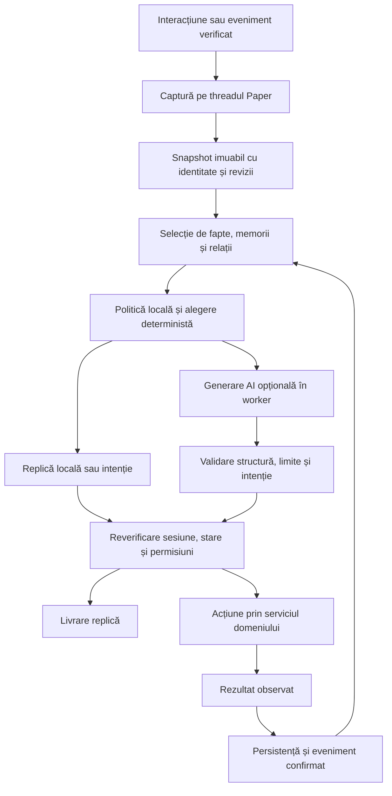

# Cerințe pentru Codex – Sistem AI avansat pentru NPC-uri Minecraft (PaperMC)

Data: 2026-10-27.

Statut: **cerințe de produs și propunere de integrare**, bazate pe proiectul AINPC existent și pe cerințele detaliate ale utilizatorului. Documentul nu certifică funcționarea pe un server Minecraft.

Ținta cerută este o simulare cu NPC-uri autonome, memorie, personalitate și învățare, organizată în AI Local, Regional și Global. NPC-urile își păstrează decizia proprie. Dialogul și deciziile folosesc aceeași stare, iar planificarea, comunicarea între agenți și simularea regiunilor neîncărcate se integrează modular. Prioritățile, bugetele și dimensiunea MVP-ului rămân propuneri tehnice.

Analiza codului, sistemele reutilizabile și etapele pentru această țintă sunt în [arhitectura agentică Local–Regional–Global](arhitectura-agentica-local-regional-global.md). Acest document păstrează cerințele comune și primul MVP local; arhitectura dedicată detaliază dezvoltarea sistemului complet.

Documentul stabilește o țintă comună de produs și criterii verificabile pentru Codex. [Constituția proiectului](../canonical/constitutie-proiect.md) și contractele runtime existente rămân autoritatea pentru comportamentul implementat. Detaliile dialogului bazat pe stare se dezvoltă în [propunerea dedicată](sistem-dialog-npc-bazat-pe-stare.md), iar evoluția circuitului cognitiv în [planul de simulare](simulare-constiinta-npc.md).

## 1. Analiza ideii

Ideea este fezabilă și potrivită pentru AINPC dacă inteligența NPC-ului pornește de la starea jocului: cine este, ce a observat, ce nevoi are, ce poate face și ce rezultate a obținut. Modelul generativ poate formula dialogul și propune intenții. Regulile din plugin stabilesc ce este adevărat și ce acțiuni sunt permise.

Valoarea pentru jucător este continuitatea. Fierarul își cunoaște atelierul, poate explica unde lucrează, recunoaște un ajutor real și își adaptează comportamentul la situația curentă. O conversație trebuie să aibă legătură cu activitățile vizibile din lume.

### Ce merită urmărit

- **Coerență:** aceeași identitate, aceleași relații și aceleași fapte confirmate între conversații și restarturi.
- **Comportament observabil:** foamea, munca, odihna și pericolul influențează alegeri care au rezultate verificabile.
- **Cunoaștere locală:** NPC-ul folosește mapping-ul semantic și informațiile la care are acces.
- **Consecințe:** ajutorul, comerțul și questurile produc efecte prin mecanicile existente.
- **Operare clară:** administratorul poate vedea motivul unei alegeri, costul AI și cauza unui fallback.

### Dificultăți și decizii recomandate

| Dificultate | Decizie propusă |
|---|---|
| Un LLM apelat continuu pentru toate NPC-urile crește latența și costul | Decizii locale; generare la interacțiuni și evenimente eligibile, cu limite globale |
| Textul generat poate inventa persoane, obiecte sau rezultate | Fapte selectate din runtime; răspunsuri deterministe pentru operații critice |
| Nevoile, dialogul și rutina pot emite intenții incompatibile | Coordonare între serviciile existente, cu o singură autoritate pentru acțiunea curentă |
| Lumea se schimbă cât timp AI-ul răspunde | Snapshot imuabil, identificatori de sesiune și reverificare înainte de livrare sau aplicare |
| O amintire spusă de jucător poate fi falsă | Proveniență și separarea afirmațiilor de evenimentele confirmate |
| O operație combină inventar Minecraft și SQL | Confirmare explicită a rezultatului, deduplicare și reconciliere după eșec |
| O extindere mare poate dubla sisteme deja construite | Incrementuri mici peste runtime-ul AINPC, cu audit înainte de implementare |

Comportamentul adaptiv se definește prin efecte măsurabile asupra alegerilor. Nu este necesară reantrenarea unui model pentru MVP. Simularea cognitivă descrie stări și reguli de joc; nu reprezintă o demonstrație de experiență subiectivă.

## 2. Punctul de plecare în proiect

Baseline-ul de build declară Kotlin `2.3.21`, Java `21` și Paper API `1.21.11-R0.1-SNAPSHOT` în [`gradle.properties`](../../gradle.properties). Aceste valori descriu proiectul analizat, fără a implica un upgrade automat.

Verificarea documentară a fost completată cu navigare Serena pentru `DialogueAiProvider`, `AIOrchestrationService`, `NpcCognitiveState`, `NpcActionExperience` și versiunea snapshotului MCP. Aceasta este o analiză punctuală, nu un audit exhaustiv sau un test în joc.

| Domeniu | Punct de plecare existent | Consecință pentru cerințe |
|---|---|---|
| Module | `ainpc-api`, `ainpc-core-plugin`, `ainpc-scenario-medieval`, `ainpc-mcp-service` | Se păstrează separarea API / runtime / conținut / sidecar |
| NPC | Identitate persistentă, profiluri, households, world bindings | Se extinde modelul existent; nu se creează un registru paralel |
| Dialog | Rutare, sesiuni, răspunsuri locale și selecție `OPENAI` / `OLLAMA` | Providerul rămâne opțional; disponibilitatea lui se verifică separat |
| Memorie și relații | Persistență și selecție de memorii, relații player–NPC și NPC–NPC | Se verifică proveniența, izolarea și retenția înainte de noi mecanisme |
| Cogniție | `NpcCognitiveState`, experiență limitată a acțiunilor și explicații locale | Se continuă circuitul existent; învățarea generală rămâne o extindere |
| Rutine | `RoutineService`, `RoutineCoordinator`, ancore și pathfinding | Se coordonează alegerile cu deplasarea și rezultatul observat |
| Lume semantică | Regiuni, places, nodes, profesii și bindings | Faptele pentru dialog provin din aceste structuri |
| Gameplay | Questuri, progression, story și economie | Intențiile aprobate folosesc serviciile domeniului |
| MCP runtime | Snapshot Paper `schemaVersion=3`; canal de comenzi separat | Citirea și scrierea au contracte și validări distincte |
| Stocare | SQLite implicit; suport MySQL/MariaDB inițial | Nu se presupun migrare versionată sau compatibilitate DB validate complet |

Surse de runtime: [inventarul existent](../canonical/implementat-deja.md), [dialog](../architecture/dialog-si-conversatii.md), [simulare](../architecture/simulation-service.md), [stocare](../reference/storage-runtime.md) și [bridge MCP](../architecture/mcp-runtime-bridge-design.md).

Unele note generale mai vechi din inventar menționează un blocaj MCP v2/v1; contractul dedicat și modelul Paper verificat descriu v3. Pentru MCP se folosește contractul dedicat, iar [checklistul de validare](../reference/mcp-runtime-gap-checklist.md) păstrează separat verificarea producer–reader în runtime. Prezența unei clase, a unui flag sau a unui test nu dovedește integrarea completă în joc.

## 3. Domeniul propus și MVP-ul

### Scenariul de referință

Se propune un sat de test cu cinci NPC-uri, de exemplu fierar, fermier, negustor, paznic și hangiu, două conturi de jucător și locuri semantice pentru casă, muncă și socializare. Numărul și profesiile sunt o configurație de test propusă; core-ul rămâne neutru, iar conținutul tematic aparține scenariului/addonului.

MVP-ul este demonstrat când:

1. un NPC poate spune cine este și unde lucrează folosind identitatea și mapping-ul reale;
2. poate indica un fierar cunoscut din sat sau poate explica lipsa informației;
3. își execută o rutină și poate descrie nevoia sau intenția curentă;
4. distinge ajutorul fizic confirmat de afirmația „ți-am dat mâncare”;
5. păstrează identitatea și datele persistente relevante după restart;
6. două persoane primesc răspunsuri bazate pe propriile relații și experiențe;
7. dialogul local funcționează când AI-ul și sidecar-ul sunt indisponibile;
8. un quest simplu și o tranzacție comercială trec prin serviciile existente;
9. există un raport de test cu rezultate observate, inclusiv limitele rămase.

### Extinderi după MVP

Cunoaștere transmisă între NPC-uri cu proveniență, obiective de durată, zvonuri, cooperare, generare de questuri în preview și adaptarea mai multor tipuri de acțiuni. Fiecare extensie cere propriul contract de persistență și criteriu de succes.

AI-ul Regional și Global, planificarea structurată, colaborarea și AI LOD fac parte din ținta completă cerută, cu etape proprii în arhitectura dedicată. Generarea fizică de clădiri, constructorul general de lume, simularea între servere și suportul Folia au cost și contracte separate și nu sunt condiții ale primului MVP local.

## 4. Arhitectura țintă

Sistemul complet are trei niveluri: Local pentru obiectivele și comportamentul NPC-ului, Regional pentru comunități/resurse/proiecte și Global pentru evenimente și relații interregionale. Nivelurile superioare publică condiții și oportunități, iar agentul local poate accepta, refuza sau negocia. Diagrama următoare detaliază circuitul local; [arhitectura dedicată](arhitectura-agentica-local-regional-global.md) definește interacțiunea celor trei niveluri.



Nodurile diagramei reprezintă responsabilități, nu clase sau module noi obligatorii. Codex trebuie să identifice mai întâi implementările și apelanții existenți.

### Separarea responsabilităților

- **Core Paper:** identități, autoritatea stării, captură de context, coordonarea rutinei și executarea acțiunilor.
- **Servicii de domeniu:** questuri, comerț, inventar, story și relații; fiecare validează propria mutație.
- **Memorie și context:** selecție relevantă, proveniență și retenție, cu date desprinse de obiectele mutable runtime.
- **Provider AI:** primește context limitat și întoarce text sau o propunere structurată; nu primește acces direct la DB ori comenzi de consolă.
- **MCP runtime:** furnizează context și operații explicit autorizate prin contractul său. Nu devine autoritatea paralelă a stării NPC.
- **Addonuri:** roluri, conținut și reguli tematice prin API public. `ainpc-api` nu depinde de implementarea core.

MCP-ul local folosit de Codex pentru memoria proiectului este infrastructură de dezvoltare. Sidecar-ul `ainpc-mcp-service` este infrastructură runtime. Cele două fluxuri nu se confundă și nu își împart automat datele.

### Contractul de execuție Paper

Citirile și mutațiile lumii/entităților care cer threadul principal se fac acolo. Contextul necesar se copiază înaintea lucrului asincron. Inferența, HTTP-ul și operațiile DB potrivite rulează în executori controlați. Nu se așteaptă futures prin `get()` sau `join()` pe threadul principal. Aceste cerințe urmează [documentația schedulerului Paper](https://docs.papermc.io/paper/dev/scheduler/).

Un callback asincron nu este presupus sigur pentru Bukkit. Înainte de livrare se revin pe schedulerul corect și se verifică identitatea NPC-ului, entitatea, lumea și sesiunea. Folia necesită proiectare și validare pentru schedulerele sale; marcarea pluginului ca fiind compatibil nu este suficientă, conform [contractului Paper/Folia](https://docs.papermc.io/paper/dev/folia-support/).

## 5. Cerințe funcționale verificabile

`P0` este obligatoriu pentru primul MVP local, iar `P1` completează ținta agentică după stabilizarea acestuia. Prioritatea nu indică absența funcționalității din cod; cerințele existente se verifică și se completează numai unde apar lipsuri.

| ID | Prioritate | Cerință | Acceptare |
|---|---|---|---|
| NPC-01 | P0 | Identitate persistentă, adresată prin UUID | Restartul și omonimele nu schimbă identitatea sau relațiile |
| NPC-02 | P0 | Profesie și ancore validate în aceeași lume | NPC-ul indică locul real sau spune că lipsește; nu inventează coordonate |
| NPC-03 | P0 | Aceeași stare cognitivă alimentează alegerea și explicația | Replica despre intenție corespunde snapshotului folosit și nu declară succesul înainte de rezultat |
| NPC-04 | P0 | Coordonare între nevoie, rutină, dialog și pericol | O întrerupere invalidează alegerea veche fără să suprascrie una nouă |
| NPC-05 | P0 | Dialog local fără provider | Identitatea, locul, nevoile și refuzul sigur funcționează offline |
| NPC-06 | P0 | Sesiuni și livrare asincronă izolate | Un răspuns întârziat nu ajunge într-o sesiune nouă sau la alt interlocutor |
| NPC-07 | P0 | Fapte semantice din runtime | Întrebarea despre fierar folosește un NPC și un loc existente, accesibile contextului |
| NPC-08 | P0 | Memorii cu proveniență și retenție | Afirmațiile jucătorului nu sunt promovate automat la evenimente confirmate |
| NPC-09 | P0 | Relații și experiențe per interlocutor | Ajutorul dat de jucătorul A nu este atribuit jucătorului B |
| NPC-10 | P0 | Acțiuni prin API-urile domeniului | Textul AI nu poate executa comenzi arbitrare sau acorda recompense direct |
| NPC-11 | P0 | Rezultatul observat este separat de intenție | Un transfer eșuat nu creează amintire de ajutor sau confirmare de plată |
| NPC-12 | P0 | Quest și comerț cu validare curentă | Eligibilitatea, stocul, costul și progresul se recitesc la aplicare |
| NPC-13 | P0 | Limite AI, timeout și fallback | Indisponibilitatea sau saturarea providerului păstrează dialogul local disponibil |
| NPC-14 | P0 | Persistență și restaurare controlate | Erorile nu suprascriu date existente cu valori implicite și nu raportează succes fals |
| NPC-15 | P0 | Diagnostic explicabil și limitat | Adminul poate vedea motivul, rezultatul și fallback-ul fără expunerea secretelor |
| NPC-16 | P1 | Obiective persistente, întreruptibile | Reluarea reverifică precondițiile; nu repetă efecte deja confirmate |
| NPC-17 | P1 | Cunoaștere transmisă cu sursă și vechime | Un zvon nu devine fapt global și poate fi contestat sau expirat |
| NPC-18 | P1 | Adaptare din rezultate pentru noi acțiuni | Testul cu aceeași situație și aceeași aleatorietate izolează efectul experienței |
| NPC-19 | P1 | Generare asistată de questuri și story | Rezultatul intră în preview validat, cu aprobare înaintea publicării |
| NPC-20 | P1 | Cooperare și planificare între NPC-uri | Contract separat pentru resurse, conflicte, anulare și recuperare |
| NPC-21 | P1 | AI Regional pentru resurse, economie și proiecte | Publică oportunități și rezervă resurse autorizate fără a impune obiective individuale |
| NPC-22 | P1 | AI Global pentru evenimente, comerț și migrație | Folosește agregate interregionale și păstrează decizia locală și propagarea explicită a cunoașterii |
| NPC-23 | P1 | AI LOD după proximitate și importanță | Respectă flagurile, distribuie munca și simulează abstract fără încărcări de chunk-uri |
| NPC-24 | P1 | Obiective proprii și planuri GOAP/HTN bounded | Compară alternative și execută pași verificați; replanifică la schimbarea precondițiilor |
| NPC-25 | P1 | Comunicare și negociere tipizate | Ofertele au termen, refuz și angajament durabil; replay-ul nu dublează efectele |
| NPC-26 | P1 | Stare și cunoaștere comune pentru dialog și planificare | Snapshoturile au revizii și proveniență; NPC-ul nu primește automat faptele globale |
| NPC-27 | P1 | Inferență partajată între NPC-uri și niveluri | Modelele sunt reutilizate cu context izolat, cozi bounded și buget comun |
| NPC-28 | P1 | Continuitate între simulare fizică și abstractă | Un UUID are un singur executant; resursele și timpul nu se dublează la unload/reload sau restart |

### Identitate, emoții și relații

Personalitatea este relativ stabilă. Emoția curentă și nevoile sunt stări temporare. Relația față de o persoană este distinctă de reputația generală. Regulile care schimbă aceste valori sunt configurabile și bounded; o singură replică nu rescrie arbitrar profilul.

### Percepție și cunoaștere

Un fapt existent în baza globală nu este automat cunoscut fiecărui NPC. Se filtrează după rol, regiune, observații, permisiunea de divulgare și valabilitate. Identitatea interlocutorului folosește UUID-ul; numele este destinat afișării și clarificării.

Exemplu de acceptare: la „Cine este fierarul din sat?”, se rezolvă regiunea, profesia și binding-ul. Dacă există două persoane eligibile, răspunsul le distinge. Dacă atelierul nu este mapat sau NPC-ul nu cunoaște informația, replica exprimă această limită. „Un fierar bun” necesită un criteriu justificabil; nu se inventează o reputație.

### Memorie și învățare

Se reutilizează stocarea și selecția existente. Modelul țintă trebuie să poată exprima tipul informației, sursa, participanții, momentul, importanța, încrederea și expirarea. Schema concretă se decide după inventarierea câmpurilor actuale; acest document nu introduce tabele obligatorii.

Evenimentele confirmate, afirmațiile, zvonurile și rezumatele rămân distincte. Un rezumat păstrează legătura cu sursele și nu poate transforma o presupunere în fapt. Rechemarea combină relevanța, recența și importanța în limite configurabile. Ștergerea ori expirarea nu trebuie ocolită printr-un rezumat sau cache vechi.

Adaptarea începe cu reguli explicite și influență limitată asupra scorurilor. O acțiune aleasă, dar invalidată sau eșuată, nu primește credit cauzal. Generalizarea între activități se adaugă numai după validarea circuitului existent.

### Rutine, deplasare și interacțiuni

Nevoile și pericolul pot întrerupe rutina după reguli explicite. Dialogul și acțiunile autonome folosesc aceeași coordonare pentru a evita intenții concurente. Cererile inițiate de NPC respectă distanța, vizibilitatea, disponibilitatea jucătorului și cooldown-uri per NPC și per destinatar.

Se diferențiază destinația aleasă, drumul pornit și sosirea observată. O ancoră într-un chunk indisponibil, un traseu blocat sau dispariția entității produce un rezultat explicit. Teleportul de fallback este o politică administrabilă și diagnosticabilă. Nu se forțează încărcarea nelimitată de chunk-uri pentru a susține simularea.

## 6. Contracte de date și consistență

Următoarele sunt câmpuri logice propuse. Ele pot fi reprezentate prin tipurile existente; numele nu constituie API public sau configurație deja implementată.

| Obiect logic | Informație minimă |
|---|---|
| Contextul cererii | `requestId`, UUID NPC, UUID interlocutor, `sessionId`, momentul capturii, revizii relevante |
| Snapshot NPC | identitate, stare/nevoi, intenție, profesie, ancore, fapte și memorii selectate |
| Propunere AI | versiune de schemă, text, tip de intenție opțional, referințe la ținte permise |
| Cerere de acțiune | `operationId`, actor, tip permis, țintă, precondiții și revizie a stării |
| Rezultat | reușit / respins / eșuat / incert, efect observat, motiv și referință la operație |
| Eveniment de memorie | sursă, participanți, dovadă, timp, încredere și retenție |

### Un singur proprietar al fiecărei mutații

Actualizările pentru același NPC se serializează sau folosesc verificarea reviziei. Două mesaje simultane nu trebuie să permită ultimei completări asincrone să suprascrie starea mai nouă. Snapshoturile includ copii ale colecțiilor și datelor JSON relevante, fără referințe Bukkit mutable în worker.

Expirarea sesiunii oprește livrarea întârziată. Nu anulează retroactiv o mutație deja confirmată. Politica pentru post-procesarea unui mesaj acceptat se definește separat; la extindere trebuie verificat contractul actual al dialogului.

### Aplicarea unei acțiuni

1. Se validează structura, tipul permis și actorul.
2. Se verifică starea actuală, permisiunile, ținta, distanța și resursele necesare.
3. Serviciul domeniului execută operația cu o identitate stabilă pentru deduplicare.
4. Numai rezultatul confirmat poate produce recompensa, memoria de fapt sau evenimentul de progres corespunzător.
5. Un rezultat ambiguu se marchează pentru reconciliere; nu se retrimite automat o mutație economică.

SQL și inventarul/lumea Minecraft nu formează automat o tranzacție comună la crash de proces. Pentru operații cu astfel de efecte se documentează ordinea aplicării, compensarea și verificarea după restart. Nu se promite execuție „exact o dată” doar printr-un UUID sau un retry. Limitele curente sunt descrise în [contractul de stocare](../reference/storage-runtime.md).

### MCP și starea disponibilității

Contextul MCP trebuie să distingă snapshot proaspăt, `STALE`, `INVALID`, `MISSING` și `OFFLINE`. Datele expirate nu sunt prezentate drept stare actuală. Contractul read-only nu produce comenzi și nu activează implicit canalul de scriere. Write tools rămân condiționate de autentificare, allowlist, audit și validare end-to-end, conform [bridge-ului existent](../architecture/mcp-runtime-bridge-design.md).

## 7. Cerințe nefuncționale

### Performanță și cost

Bugetele de mai jos sunt puncte de pornire propuse, nu rezultate măsurate sau promisiuni de capacitate. Ele se ajustează după profilarea hardware-ului și a lumii de test.

| Parametru | Țintă inițială propusă | Verificare |
|---|---|---|
| LLM în bucla de tick | Niciun apel obligatoriu | Rutina și simularea continuă cu providerul oprit |
| Paralelism AI global | Maximum 4 cereri active și 16 în așteptare | Saturarea declanșează fallback controlat, fără creștere nelimitată |
| Concurență dialog | Cel mult o generare activă per sesiune | Mesajele sunt ordonate sau primesc răspuns de ocupare explicit |
| Termen de răspuns generativ | 8 secunde până la fallback, incluzând așteptarea în coadă | Rezultatele sosite după termen nu sunt livrate în locul fallback-ului |
| Dimensiune context AI | 3.000 tokenuri de intrare și 200 de ieșire pentru dialog simplu | Politică explicită de selecție și trunchiere; fără pierderea regulilor obligatorii |
| Cost cumulat | Plafon configurabil de cereri și tokenuri pe interval | Depășirea oprește generarea și păstrează răspunsurile locale |
| Încărcare de profilare | 25 NPC-uri cu simulare completă și 200 în mod redus/inactiv | Se măsoară separat de scenariul MVP cu cinci NPC-uri |
| Cost sincron AINPC | Țintă p95 de maximum 2 ms per tick în profilul declarat | Măsurare agregată a muncii sincrone; se raportează și vârfurile |
| Retenție | Memorii, cozi, cache-uri și diagnostice bounded | Se publică limitele și politica de expirare/evacuare |

Tokenurile se estimează sau se numără printr-o metodă compatibilă cu providerul, documentată. O limită în caractere nu este raportată ca număr exact de tokenuri. Cache-ul de răspuns nu se partajează între jucători fără includerea identității, relației, stării și reviziilor relevante în cheie.

### Reziliență și lifecycle

- Timeout-uri, anulare best-effort, backoff limitat și circuit breaker pentru cereri externe; retry automat numai unde efectele îl permit.
- Închiderea pluginului oprește acceptarea lucrului nou și finalizează sau raportează operațiile în curs în limite documentate.
- Disable/reload invalidează callback-urile vechi printr-o generație de lifecycle; acestea nu readuc în memorie entități sau servicii închise.
- Schimbările de schemă cer backup, strategie de migrare și verificare de restaurare. Copierea unui SQLite activ în WAL nu este presupusă backup consistent.
- Suportul MySQL se declară validat numai după integrare pe backend real; testele SQLite sau traducerea SQL nu îl substituie.

### Limite de încredere și configurare

Mesajele jucătorilor, memoriile, profilurile importate și rezultatele MCP/AI sunt date cu nivel de încredere explicit. Nu pot modifica regulile de sistem sau autoriza operații. Validarea JSON dovedește forma, nu adevărul semantic al unei replici. Pentru bani, inventar, progres și fapte critice se folosesc rezultate deterministe și formulări controlate.

Se trimit providerului numai date necesare, fără chei API sau datele altui interlocutor. Endpoint-urile și modelele sunt configurate de administrator. Serviciile locale păstrează bind-urile `127.0.0.1`; o expunere remote cere o fază explicită separată.

Feature-urile majore pot fi oprite complet. Noile acțiuni autonome și mutații AI intră inițial ca preview, read-only sau disabled by default, după impact. Cheile de config existente se inventariază înainte de adăugare; nu se creează flaguri sinonime pentru aceeași capacitate.

### Observabilitate

Diagnosticul trebuie să explice sursa datelor, motivul alegerii, starea sesiunii, fallback-ul, durata, consumul AI și rezultatul acțiunii. Identificatorii de corelare leagă cererea de operație fără logarea implicită a conversației integrale. Auditul păstrează metadata compactă și aplică retenție; detaliile sensibile au acces și export controlate.

## 8. Plan de lucru pentru Codex

Ordinea respectă principiul proiectului: verificarea baseline-ului și a gameplay-ului precede extinderea autonomiei.

| Etapă | Livrabil | Condiție de închidere |
|---|---|---|
| E0 – Inventar | Hartă cerință → simbol/apelant → test → verificare runtime | Fiecare P0 este clasificat existent, parțial sau lipsă pe baza dovezilor |
| E1 – Baseline în joc | Satul de referință și raport de smoke pentru dialog, rutină și persistență | Fluxurile sunt observate pe Paper; blocajele sunt documentate și prioritizate |
| E2 – Context coerent | Completări punctuale pentru proveniență, izolare și snapshoturi | Fără contaminare între jucători, sesiuni sau revizii în scenariile reproduse |
| E3 – Acțiune și rezultat | Coordonare, invalidare și rezultat observat pentru activitățile MVP | Nicio confirmare de succes la eșec sau invalidare; restartul este verificat |
| E4 – Provider opțional | Bugete, timeout, coadă bounded și fallback | Modurile local, online, saturat și indisponibil trec aceleași cerințe de consistență |
| E5 – MVP verificabil | Quest, comerț, raport de performanță și runbook de operare | Toate P0 au dovezi și limite explicite; defectele blocante sunt închise |
| E6 – Sistem agentic complet | Etapele AG1–AG7 din arhitectura dedicată | Planuri locale, LOD, comunicare, coordonare regională/globală și adaptare au dovezi separate |

Nu se construiește în paralel un nou `MemoryManager`, `DecisionEngine`, registru NPC sau motor de rutine. O interfață suplimentară se justifică numai dacă separă o responsabilitate reală și are un consumator concret. GOAP/HTN completează selecția locală cu planuri structurate; mașinile de stări existente pot executa primele planuri. Behavior Trees și servicii separate se introduc când rezolvă o nevoie concretă, păstrând același contract de execuție.

### Fișa fiecărui task

Fiecare task de implementare trebuie să conțină: ID-urile cerințelor, problema observată, comportamentul dorit, simbolurile și apelanții afectați, limita schimbării, criteriile de acceptare, validarea și documentația de actualizat. Pentru mutații persistente se adaugă migrarea și recuperarea. Nu se marchează „terminat” numai pentru că există clasa sau testul compilează.

## 9. Scenarii de acceptare

Scenariile folosesc date de test. Numele și profesiile exemplificate nu sunt afirmații despre lumea curentă.

| ID | Scenariu | Rezultat necesar | Nivel de validare |
|---|---|---|---|
| A01 | Întrebare despre fierar cu mapping valid, lipsă și ambiguu | Numai ținte reale și clarificare ori necunoaștere explicită | Test de rezolvare + Paper |
| A02 | Jucătorul afirmă că a oferit hrană fără transfer | Nicio dovadă de ajutor sau recompensă inventată | Test de politică + Paper |
| A03 | Transfer reușit, transfer eșuat și alt interlocutor | Credit numai pentru transferul confirmat și UUID-ul corect | Integrare inventar/persistență + Paper |
| A04 | Același NPC, doi jucători și două relații diferite | Fără scurgere de memorie sau atribuirea ajutorului altuia | Test de izolare + Paper |
| A05 | Răspuns AI întârziat după schimbare/expirare de sesiune | Nu se livrează replica sau eroarea vechii sesiuni | Concurență controlată + Paper |
| A06 | Entitate eliminată, teleportată ori invalidată în callback | Nicio aplicare pe starea veche și nicio învățare falsă | Regresie pe bucla publică + Paper |
| A07 | Destinație blocată sau chunk indisponibil | Eșec explicit și fallback limitat, fără buclă de încărcare/teleport | Paper cu traseu controlat |
| A08 | Provider fără cheie, timeout, răspuns invalid sau coadă plină | Dialog local disponibil și motiv diagnosticabil | Fault injection + Paper |
| A09 | Mesaj care cere ignorarea regulilor sau recompense arbitrare | Textul nu produce mutații în afara API-urilor permise | Test de limită de încredere |
| A10 | Același eveniment de quest ori aceeași cerere de cumpărare repetată | Fără recompensă/plată duplicată; eligibilitatea este recitită | Integrare de domeniu + Paper |
| A11 | Restart după succes și după eșec de persistare | Stare restaurată corect sau incident explicit, fără succes fals | DB reală + restart Paper |
| A12 | Crash între efectul Minecraft și salvarea SQL | Rezultat ambiguu detectabil și procedură de reconciliere verificată | Integrare cu fault injection; pe copie de test |
| A13 | MCP proaspăt, stale, invalid și oprit | Contextul indisponibil nu devine fapt actual; citirea nu creează comenzi | Contract producer–reader + Paper/sidecar |
| A14 | Încărcare de profilare timp de 30 minute, după încălzire | Durate, vârfuri, cozi, memorie și cost AI raportate față de baseline | Profilare pe server |
| A15 | Dezactivare feature sau plugin cu cereri active | Callback-urile vechi nu aplică acțiuni și nu reactivează servicii | Lifecycle controlat + Paper |
| A16 | Experiență prezentă/absentă în condiții identice | Influența asupra alegerii este izolată de aleatorietate și invalidări | Test cauzal + observație în joc |

Nu se cere o formulare textuală identică pentru replicile generative. Se verifică faptele permise, țintele, efectele și absența unor confirmări false. Determinismul se cere politicilor și tranzițiilor, cu timp și aleatorietate controlate în teste.

Pentru fiecare scenariu se consemnează versiunea pluginului, configurația, lumea de test, pașii, rezultatul efectiv și dovezile. Testele unitare, integrarea DB și smoke-ul Paper sunt dovezi diferite. Un rezultat existent în documentație nu este rerulat sau declarat PASS automat.

Cerințele NPC-20–NPC-28 au și scenariile AG-A01–AG-A12 din [arhitectura agentică](arhitectura-agentica-local-regional-global.md), inclusiv refuzul autonom, resursele conservate între LOD-uri și propagarea cunoașterii între regiuni.

## 10. Instrucțiune reutilizabilă pentru Codex

Textul următor este destinat unui task ulterior de implementare. Cererea curentă produce documentația, fără a activa aceste schimbări runtime.

```text
Lucrează incremental la sistemul AI pentru NPC-uri AINPC, folosind documentul
docs v2/planning/cerinte-codex-sistem-ai-avansat-npc-papermc.md.
Folosește și docs v2/planning/arhitectura-agentica-local-regional-global.md
pentru ținta Local/Regional/Global, planificare, comunicare și AI LOD.

Începe cu E0: clasifică cerințele P0 ca existente, parțiale sau lipsă și
identifică simbolurile, apelanții, testele și verificările în joc relevante.
Respectă AGENTS.md și constituția proiectului. Folosește MCP pentru context,
activează Serena și citește instrucțiunile sale. Consultă Context7 pentru
API-uri externe. Verifică worktree-ul și păstrează schimbările existente.

După inventar, implementează un singur increment necesar scenariului MVP,
cu criterii de acceptare explicite. Refolosește serviciile existente.
Păstrează core-ul determinist, providerul AI opțional și contextul imuabil.
Execută operațiile Bukkit/Paper pe threadul cerut de API și nu bloca tick-ul.
Tratează intenția, aplicarea și rezultatul confirmat ca stări distincte.
Nu permite textului generat să acorde bani, obiecte sau progres direct.

Validează schimbarea prin cele mai apropiate teste relevante și documentează
separat ce a fost verificat pe Paper. Pentru modificări persistente, descrie
migrarea, backup-ul și recuperarea după eșec. Actualizează contractul de
runtime afectat și jurnalul MCP, cu metadata compactă și fără secrete.
Raportează rezultatul, dovezile și limitele rămase.
```

## 11. Decizii de confirmat la pregătirea implementării

- Numărul țintă de NPC-uri active, jucătorii simultani și hardware-ul serverului.
- Rolurile și mecanicile obligatorii pentru primul sat jucabil.
- Preferința pentru provider local, extern sau funcționare exclusiv deterministă și bugetul disponibil.
- Politicile concrete pentru acțiunile autonome, resursele comunitare și operațiile care cer confirmare din partea jucătorului/adminului.
- Politica de retenție a conversațiilor și datelor despre jucători.
- Backend-ul DB și versiunile Paper care trebuie validate pentru release.

Până la clarificare se folosește MVP-ul propus, se păstrează baseline-ul tehnic și se prioritizează verificarea fluxurilor existente. Aceste ipoteze nu autorizează deploy, upgrade de infrastructură sau activarea automată a feature-urilor experimentale.

## 12. Documente de continuare

- [Arhitectură agentică Local–Regional–Global](arhitectura-agentica-local-regional-global.md) – analiza codului, modulele reutilizabile, contractele și etapele pentru simularea completă.
- [Dialog bazat pe stare persistentă](sistem-dialog-npc-bazat-pe-stare.md) – modelul detaliat al memoriei, cunoașterii și conversației.
- [Circuit cognitiv și etape](simulare-constiinta-npc.md) – ce este implementat punctual și ce rămâne planificat.
- [Contractul runtime al simulării](../architecture/simulation-service.md) – nevoi, alegeri și experiență.
- [Contractul runtime al dialogului](../architecture/dialog-si-conversatii.md) – rutare, sesiuni și livrare.
- [MCP runtime](../architecture/mcp-runtime-bridge-design.md) și [checklistul său](../reference/mcp-runtime-gap-checklist.md) – snapshot și limitele canalului de comenzi.
- [Stocare runtime](../reference/storage-runtime.md) și [roadmap DB](storage-provider-roadmap.md) – persistență, tranzacții și extinderi.
- [Debugging și smoke cognitiv](../operations/debugging-si-testare.md#smoke-test-cognitiv) – verificarea comportamentului în Minecraft.
- [Politica coroutines/Paper](../reference/kotlin-coroutines-paper-policy.md) – convențiile proiectului pentru concurență.
- [Siguranța prompturilor](../reference/prompt-safety-guide.md) – limitele de încredere ale contextului AI.

Sursele externe au fost consultate la 2026-10-27 prin Context7 și documentația oficială PaperMC. Recomandările de produs, bugetele și fazele sunt propuneri pentru AINPC; nu sunt garanții oferite de PaperMC sau de un provider AI.
